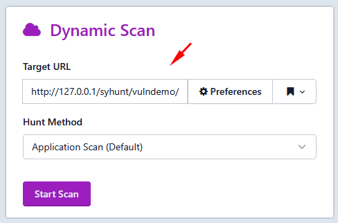
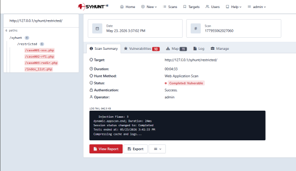
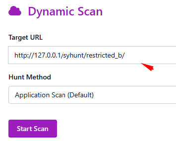
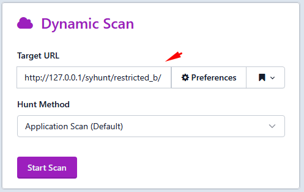
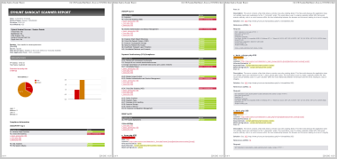
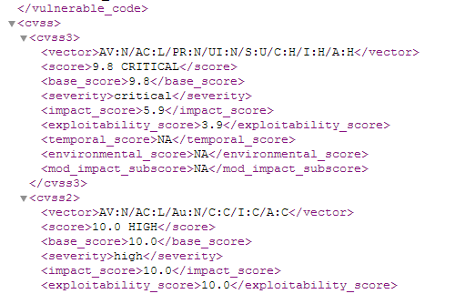
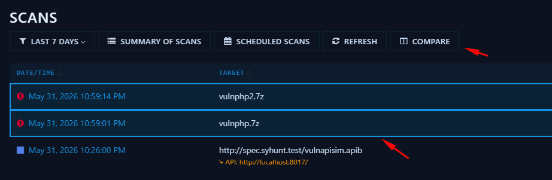

# Plano de Testes de Prova de Conceito

> **Aplica-se a:** Syhunt Hybrid 7.2

> [!NOTE]
> Este plano de testes foi elaborado para o **Syhunt Hybrid**, a edição completa. O Syhunt Community tem funcionalidades e verificações de vulnerabilidades restritas; por isso, alguns casos de teste não podem ser executados com ele e nem todas as vulnerabilidades serão detectadas.

## Introdução

Este plano de testes verifica o funcionamento, a precisão e a correta operação de todas as partes principais do Syhunt Hybrid. Ele deve ser executado nas instalações do cliente, após a implantação e ativação do Syhunt Hybrid, e consiste em varreduras dinâmicas e estáticas executadas em diversas condições que simulam o uso real. Ao final, você estará familiarizado com os principais recursos do produto e com as opções de integração, e a Syhunt poderá coletar seu feedback sobre a usabilidade.

### Casos de teste

| Fase | Caso de teste |
|---|---|
| **1. Auditoria dinâmica** | [D1: Varredura de vulnerabilidades em um site ativo](#D1) |
| | [D2: Login manual pelo navegador e varredura de um site restrito](#D2) |
| | [D3: Login automático e varredura de um site restrito](#D3) |
| | [D4: Apenas mapear um site (teste de rastreamento com execução de JavaScript)](#D4) |
| | [D5: Varredura dinâmica incremental](#D5) |
| | [D6: Varreduras dinâmicas simultâneas](#D6) |
| **2. Auditoria de código-fonte** | [S1: Varredura de arquivos de código-fonte locais](#S1) |
| | [S2: Varredura de repositórios Git remotos](#S2) |
| **3. Integração** | [N1: Iniciar uma varredura de código pela linha de comando](#N1) |
| | [N2: Iniciar uma varredura dinâmica pela linha de comando](#N2) |
| | [N3: Criar uma issue em um rastreador a partir de uma vulnerabilidade relatada](#N3) |
| | [N4: Gerar uma exportação compatível com o F5 BIG-IP ASM](#N4) |
| **4. Relatórios** | [R1: Gerar um relatório HTML padrão](#R1) |
| | [R2: Gerar um relatório HTML completo](#R2) |
| | [R3: Exportar os resultados da varredura em XML](#R3) |
| | [R4: Editar uma vulnerabilidade relatada](#R4) |
| | [R5: Gerar um relatório comparativo entre varreduras](#R5) |

<a id="envreq"></a>

## Requisitos do ambiente

Os resultados deste plano foram obtidos no Windows 11 x64 com um Intel Core i9, 64 GB de RAM, SSD de 1 TB e acesso à Internet. Certifique-se de ter um SSD rápido e acesso à Internet, e de atender pelo menos aos [requisitos mínimos de sistema](../reference/technical-specifications.md#specsbegin).

O plano pressupõe que o Syhunt Hybrid já esteja instalado na máquina Windows que executará os testes e que a interface web esteja habilitada. Caso não esteja:

1. Baixe o instalador pelo link fornecido pela Syhunt, clique duas vezes nele e siga o instalador (*Next → Next → Finish*). O Syhunt Hybrid é aberto quando você clica em **Finish**.
2. [Habilite a interface web do Syhunt](../installation/web-ui.md#firststeps).
3. Na página inicial da interface web, informe a chave Pen-Tester Key recebida no e-mail que continha o link de download e clique em **Apply**. Uma mensagem de sucesso confirma que o Syhunt está pronto para os testes.

<a id="preyserver"></a>

### Prey Server

O Prey Server é um servidor web Apache/PHP portátil que inclui um conjunto de aplicações web propositalmente vulneráveis, para fins de demonstração.

1. Baixe-o em <https://syhunt.fra1.cdn.digitaloceanspaces.com/tools/hybrid_xtras/syhunt-vulnphpserver.zip>.
2. Descompacte-o em uma pasta de sua escolha.
3. Execute `PreyServer.exe`.
4. Execute `mysql\start.exe` para iniciar o servidor MySQL.
5. Abra <http://127.0.0.1/syhunt/vulndemo> no navegador. Você verá a página de boas-vindas:


### Git for Windows

Os casos de teste relacionados ao Git exigem o [Git for Windows](https://gitforwindows.org/). Instale-o com as configurações padrão e confirme que o comando `git` funciona no Prompt de Comando.

<a id="scantime"></a>

## Tempo estimado das varreduras

- **Varreduras dinâmicas (fase 1)** levam cerca de **5 minutos** cada, nos alvos recomendados. A varredura incremental de [D5](#D5) leva cerca de metade desse tempo.
- **Varreduras de código (fase 2)** levam cerca de **10 segundos** nos alvos recomendados. Para comparação, um projeto Java + JavaScript maior, com cerca de 200.000 linhas, leva em torno de 4 minutos, e uma nova varredura incremental do mesmo código leva cerca de metade disso. Ou seja, o Syhunt analisa aproximadamente 6 milhões de linhas de código por hora, e cerca de 12 milhões por hora em varreduras recorrentes dos mesmos alvos.

## Fase 1: Auditoria dinâmica

<a id="D1"></a>

### D1. Varredura de vulnerabilidades em um site ativo

**Ação:** fazer a varredura de <http://127.0.0.1/syhunt/vulndemo> em busca de vulnerabilidades.

**Resultado esperado:** ao final da varredura, a aba **Vulnerabilities** lista todos os casos de teste, de 001 a 012.

[](https://www.syhunt.com/pub/screenshots/poctestplan/d1.png)

**Passos:**

1. Certifique-se de que o Prey Server está em execução (consulte [Prey Server](#preyserver)).
2. Abra a página inicial do Syhunt Hybrid, `https://127.0.0.1:8018/syhunt/`, e clique no botão **New Scan** do Dynamic.<br>
3. Informe `http://127.0.0.1/syhunt/vulndemo` como URL alvo.<br>
4. Selecione o método de varredura **Application Scan (Default)**, que procura todas as vulnerabilidades usando as configurações recomendadas.
5. Clique em **Start Scan**.

<a id="D2"></a>

### D2. Login manual pelo navegador e varredura de um site restrito

**Ação:** fazer a varredura de <http://127.0.0.1/syhunt/restricted>, que usa autenticação por formulário web.

**Resultado esperado:** ao final da varredura, a aba **Vulnerabilities** lista todos os casos de teste, de 001 a 003.

[](https://www.syhunt.com/pub/screenshots/poctestplan/d2.png)

**Passos:**

1. Certifique-se de que o Prey Server está em execução (consulte [Prey Server](#preyserver)).
2. Certifique-se de que a extensão de navegador [Syhunt Sandcat](../installation/install-windows.md#sandcat) está habilitada.
3. No navegador, acesse <http://127.0.0.1/syhunt/restricted>.
4. Faça login com o usuário **test** e a senha **CUBPzjVy**.
5. Clique no ícone do Syhunt Sandcat na barra de ferramentas do navegador e depois em **Scan This Site**.<br>
6. Aparece uma tela com uma captura do site e a mensagem verde **Session Ready**.
7. Selecione o método de varredura **Application Scan (Default)**.
8. Clique em **Start Scan**.

<a id="D3"></a>

### D3. Login automático e varredura de um site restrito

**Ação:** fazer a varredura de <http://127.0.0.1/syhunt/restricted_b>, que usa autenticação HTTP Basic.

**Resultado esperado:** ao final da varredura, os resultados listam todos os casos de teste, de 001 a 003.

[](https://www.syhunt.com/pub/screenshots/poctestplan/d3.png)

**Passos:**

1. Certifique-se de que o Prey Server está em execução (consulte [Prey Server](#preyserver)).
2. Abra `https://127.0.0.1:8018/syhunt/` e clique no botão **New Scan** do Dynamic.<br>
3. Informe `http://127.0.0.1/syhunt/restricted_b` como URL alvo.<br>
4. Selecione o método de varredura **Application Scan (Default)**.
5. Clique em **Preferences**.<br>
6. Na aba **Authentication**, defina **Authentication** como **Basic**.
7. Informe o usuário **test** e a senha **test** e clique em **Save**.
8. Clique em **Start Scan**.

<a id="D4"></a>

### D4. Apenas mapear um site (teste de rastreamento com execução de JavaScript)

**Ação:** rastrear <http://test.syhunt.com/spider>.

**Resultado esperado:** ao final da varredura, ao expandir a árvore do site na barra lateral esquerda, aparece a estrutura do site, incluindo todos os casos de teste de 001 a 009 no diretório `/passed/`.


**Passos:**

1. Abra `https://127.0.0.1:8018/syhunt/` e clique no botão **New Scan** do Dynamic.<br>
2. Informe `http://test.syhunt.com/spider` como URL alvo.<br>
3. Selecione o método de varredura **Spider Only**.
4. Clique em **Start Scan**.

<a id="D5"></a>

### D5. Varredura dinâmica incremental

**Ação:** fazer duas varreduras de <http://127.0.0.2/syhunt/vulndemo>.

**Resultado esperado:** a primeira varredura leva cerca de 4 minutos; a segunda, cerca de metade disso (em torno de 2 minutos). Após cada varredura, os resultados listam todos os casos de teste, de 001 a 012.

[](https://www.syhunt.com/pub/screenshots/poctestplan/d5.png)

**Passos:**

1. Siga os passos de [D1](#D1), mas use `127.0.0.2` em vez de `127.0.0.1` como alvo, pois a varredura incremental não fica habilitada para `127.0.0.1`.
2. Repita os mesmos passos para fazer uma segunda varredura de `127.0.0.2`.

<a id="D6"></a>

### D6. Varreduras dinâmicas simultâneas

**Ação:** executar duas varreduras simultâneas de <http://127.0.0.1/syhunt/vulndemo>.

**Resultado esperado:** ao final das varreduras, a aba **Vulnerabilities** de cada uma lista todos os casos de teste, de 001 a 012. A barra lateral direita mostra o status de cada varredura, marcado em vermelho.

[](https://www.syhunt.com/pub/screenshots/poctestplan/d6.png)

**Passos:**

1. Siga os passos de [D1](#D1).
2. Antes que a varredura termine, volte à tela inicial do Syhunt Hybrid e repita os passos 2 a 5 de [D1](#D1) para iniciar uma segunda varredura do mesmo alvo.

## Fase 2: Auditoria de código-fonte

<a id="S1"></a>

### S1. Varredura de arquivos de código-fonte locais

**Ação:** iniciar uma varredura de código de um arquivo compactado local pela interface.

**Resultado esperado:** ao final da varredura, a aba **Vulnerabilities** lista todos os casos de teste, de 001 a 009.

**Passos:**

1. Baixe <https://github.com/syhunt/vulnphp/archive/master.zip> pelo navegador.
2. Abra a página inicial do Syhunt Hybrid e clique no botão **New Scan** do Code.<br>
3. Na aba **File**, clique em **Choose File** e selecione o arquivo `master.zip` baixado.
4. Certifique-se de que o método de varredura **Code Scan (Default)** está selecionado.
5. Clique em **Start Scan**.

Você pode repetir este teste com amostras vulneráveis em outras linguagens (o número de casos de teste varia conforme o arquivo):

| Linguagem | Arquivo |
|---|---|
| Java | <https://github.com/syhunt/vulnjava-wavsep/archive/master.zip> |
| Lua | <https://github.com/syhunt/vulnlua/archive/master.zip> |
| PHP | <https://github.com/syhunt/vulnphp/archive/master.zip> |

<a id="S2"></a>

### S2. Varredura de repositórios Git remotos

**Ação:** iniciar uma varredura de código de um repositório Git remoto.

**Resultado esperado:** ao final da varredura, os resultados listam todos os casos de teste, de 001 a 009.

**Passos:**

1. Abra a página inicial do Syhunt Hybrid e clique no botão **New Scan** do Code.<br>
2. Informe `https://github.com/syhunt/vulnphp.git` como URL do projeto.
3. Certifique-se de que o método de varredura **Code Scan (Default)** está selecionado.
4. Clique em **Start Scan**.

Você pode repetir este teste com repositórios em outras linguagens (o número de casos de teste varia conforme o repositório):

| Linguagem | Repositório |
|---|---|
| Java | `https://github.com/syhunt/vulnjava-wavsep.git` |
| Lua | `https://github.com/syhunt/vulnlua.git` |
| PHP | `https://github.com/syhunt/vulnphp.git` |

## Fase 3: Integração

<a id="N1"></a>

### N1. Iniciar uma varredura de código pela linha de comando

**Ação:** fazer a varredura de <https://github.com/syhunt/vulnphp> pela interface de linha de comando.

**Resultado esperado:** ao final da varredura, os resultados listam todos os casos de teste, de 001 a 009.

**Passos:**

1. Abra um Prompt de Comando na pasta de instalação do Syhunt Hybrid (consulte [Linha de Comando](../integrations/command-line.md#intro)).
2. Execute:

   ```
   scancode https://github.com/syhunt/vulnphp.git
   ```

<a id="N2"></a>

### N2. Iniciar uma varredura dinâmica pela linha de comando

**Ação:** fazer a varredura de <http://127.0.0.1/syhunt/vulndemo> pela interface de linha de comando.

**Resultado esperado:** ao final da varredura, os resultados listam todos os casos de teste, de 001 a 012.

**Passos:**

1. Certifique-se de que o Prey Server está em execução (consulte [Prey Server](#preyserver)).
2. Abra um Prompt de Comando na pasta de instalação do Syhunt Hybrid (consulte [Linha de Comando](../integrations/command-line.md#intro)).
3. Execute:

   ```
   scanurl 127.0.0.1/syhunt/vulndemo
   ```

<a id="N3"></a>

### N3. Criar uma issue em um rastreador a partir de uma vulnerabilidade relatada

**Ação:** criar uma issue no GitHub a partir de uma vulnerabilidade relatada.

**Resultado esperado:** depois de adicionar um conector do GitHub e enviar uma vulnerabilidade, ela aparece como issue no seu repositório do GitHub.

**Passos:**

1. Crie uma conta no GitHub, se ainda não tiver, e crie um repositório de teste.
2. Adicione um conector do GitHub no Syhunt, conforme descrito em [Rastreadores de Issues](../integrations/issue-trackers.md).
3. Abra **Scans** no menu.<br>
4. Clique em uma varredura com status **Vulnerable** e vá para a aba **Vulnerabilities**.
5. Selecione a vulnerabilidade que deseja enviar ao GitHub.
6. Clique em **Send To → *nome do seu conector*** para enviá-la.<br>

<a id="N4"></a>

### N4. Gerar uma exportação compatível com o F5 BIG-IP ASM

**Ação:** gerar um arquivo de exportação ASM para uma varredura.

**Resultado esperado:** depois de clicar em **Download**, o navegador abre o arquivo XML compatível, que pode então ser importado no BIG-IP ASM.

**Passos:**

1. Abra **Scans** no menu.<br>
2. Clique com o botão direito em uma varredura com status **Vulnerable** e escolha **Generate Report**.
3. Selecione o modelo de relatório **Complete**.
4. Defina **Format** como **XML ASM generic scanner format**.
5. Clique em **Generate** e depois em **Download**.

## Fase 4: Relatórios

<a id="R1"></a>

### R1. Gerar um relatório HTML padrão

**Ação:** gerar um relatório de uma varredura, ordenando as vulnerabilidades pelo CVSS 3.

**Resultado esperado:** depois de clicar em **Generate**, o navegador permite baixar o relatório HTML.



**Passos:**

1. Abra **Scans** no menu.<br>
2. Clique em uma varredura com status **Vulnerable**, vá para a aba **Vulnerabilities** e clique em **Export**.
3. Selecione o modelo de relatório **Standard**, se ainda não estiver selecionado.
4. Selecione o método de ordenação **CVSS**, se ainda não estiver selecionado.
5. Clique em **Generate** (canto inferior esquerdo da aba) e depois em **Download**.

<a id="R2"></a>

### R2. Gerar um relatório HTML completo

**Ação:** gerar um relatório completo de uma varredura, ordenando as vulnerabilidades pelo CVSS 3.

**Resultado esperado:** depois de clicar em **Generate**, o navegador permite baixar o relatório HTML.

**Passos:**

1. Abra **Scans** no menu.<br>
2. Clique em uma varredura com status **Vulnerable**, vá para a aba **Vulnerabilities** e clique em **Export**.
3. Selecione o modelo de relatório **Complete**.
4. Selecione o método de ordenação **CVSS**, se ainda não estiver selecionado.
5. Clique em **Generate** (canto inferior esquerdo da aba) e depois em **Download**.

<a id="R3"></a>

### R3. Exportar os resultados da varredura em XML

**Ação:** gerar um arquivo XML com os resultados de uma varredura.

**Resultado esperado:** depois de clicar em **Download**, o navegador permite baixar o arquivo XML de resultados.



**Passos:**

1. Abra **Scans** no menu.<br>
2. Clique em uma varredura com status **Vulnerable**, vá para a aba **Vulnerabilities** e clique em **Export**.
3. Selecione o modelo de relatório **Complete**.
4. Defina o formato de saída como **XML**.
5. Clique em **Generate** e depois em **Download**.

<a id="R4"></a>

### R4. Editar uma vulnerabilidade relatada

**Ação:** editar os detalhes de uma vulnerabilidade relatada.

**Resultado esperado:** a tela de edição da vulnerabilidade é aberta. Depois de salvar as alterações, todo relatório gerado inclui as informações editadas.


**Passos:**

1. Abra **Scans** no menu.<br>
2. Clique em uma varredura com status **Vulnerable** e vá para a aba **Vulnerabilities**.
3. Clique em uma vulnerabilidade. A tela de detalhes é aberta.
4. Na aba **Notes**, adicione algumas observações.
5. Clique em **Save**.

<a id="R5"></a>

### R5. Gerar um relatório comparativo entre varreduras

**Ação:** gerar um relatório que compara duas varreduras.

**Resultado esperado:** o relatório gerado corresponde à tela de comparação e lista os casos de teste 007 a 009 como removidos.

[](https://www.syhunt.com/pub/screenshots/poctestplan/r5.png)

**Passos:**

1. Siga os passos de [S1](#S1), mas extraia o arquivo para uma pasta e faça a varredura dessa pasta.
2. Ao final da varredura, exclua os casos de teste 007 a 009 dessa pasta.
3. Faça uma nova varredura da pasta.
4. Abra **Scans** no menu.<br>
5. Selecione as duas varreduras mais recentes e clique em **Compare**, no topo da tela.<br>
