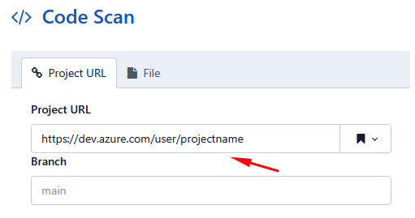

# Azure DevOps

> **Aplica-se a:** Syhunt Hybrid 7.2

Desde a versão 6.9.6, o Syhunt Community e o Syhunt Hybrid podem se conectar ao Azure DevOps Services, ao Azure DevOps Server e ao Team Foundation Server (TFS) e fazer a varredura do código-fonte dos projetos em busca de vulnerabilidades e fraquezas de segurança de aplicações.

Este recurso está disponível pela interface e pela CLI no Windows e funciona com projetos locais e hospedados na nuvem, tanto TFVC quanto Git. Sem configuração adicional, o Syhunt suporta o Azure DevOps Services, o Azure DevOps Server 2020 e 2019 e o TFS 2018 até o 2015. Como explicado abaixo, ele também pode ser configurado para se conectar a versões mais antigas do TFS (2013, 2012 e 2010).

<a id="tfstoolssuite"></a>

Para automação de pipelines, consulte também a [integração com PowerShell](powershell.md).

> [!NOTE]
> O suporte ao TFS no Syhunt Community e no Hybrid se baseia na ferramenta de exportação desenvolvida pelo Microsoft MVP Neno Loje, disponível gratuitamente [no site dele](https://blogs.msmvps.com/vstsblog/). Ela acompanha o Syhunt com a permissão do desenvolvedor.

<a id="languages"></a>

## Versões suportadas

| Versão | Implantação |
|---|---|
| Azure DevOps Services 2021 | Nuvem |
| Azure DevOps Server 2020 / 2019 | Local (on-premises) |
| Team Foundation Server 2018 / 2015 | Local (on-premises) |
| Team Foundation Server 2013 / 2012 / 2010 | Local (on-premises)\* |

\* A varredura de projetos no TFS 2010–2013 exige o Microsoft Visual Studio ou o Microsoft Team Explorer na mesma máquina do Syhunt.

Para fazer a varredura de repositórios Git (e não apenas TFVC), instale o [Git for Windows](https://gitforwindows.org/) na mesma máquina.

## Formatos de URL de projeto

| Repositório | Exemplo de alvo |
|---|---|
| Azure DevOps Services, TFVC | `https://dev.azure.com/user/projectname` |
| Azure DevOps Services, Git | `https://dev.azure.com/user/projectname/_git/projectname` |
| Azure DevOps Server | `https://myserver/tfs/projectname` |
| Azure DevOps Services / Server / TFS, por coleção | `collection:https://dev.azure.com/user$/projectname` |

Com o formato `collection:`, o Syhunt se conecta à coleção de projetos em `https://dev.azure.com/user` e faz a varredura do caminho de servidor `$/projectname`.

## Varredura pela interface

Na interface web do Syhunt Hybrid (ou na interface gráfica do Community), clique em **New Scan**, selecione **Project URL** e informe a URL do projeto, conforme descrito em [Varredura de Código-Fonte](../scanning/code-scanning.md#code_begin). Isso funciona para projetos Azure DevOps e TFS/TFVC, bem como para repositórios Git hospedados no Azure DevOps. Você também pode agendar varreduras de código de URLs de projeto com o [agendador de varreduras](../scanning/scheduling.md).



O Syhunt pede suas credenciais do Azure DevOps antes de se conectar, a menos que você já tenha se autenticado.

Para se conectar a um servidor TFS mais antigo (2010 a 2013), escolha a versão na aba **Advanced**. Como mencionado acima, isso exige o Visual Studio ou o Team Explorer na mesma máquina.

## Varredura pela linha de comando

```bat
scancode https://dev.azure.com/user/projectname
scancode https://myserver/tfs/projectname
scancode collection:https://dev.azure.com/user$/projectname
```

O Syhunt pede suas credenciais do Azure DevOps antes de se conectar, a menos que você já tenha se autenticado.

Para servidores TFS mais antigos, informe a versão com `-tfsv`:

```bat
scancode https://myserver/tfs/projectname -tfsv:2013
scancode https://myserver/tfs/projectname -tfsv:2012
scancode https://myserver/tfs/projectname -tfsv:2010
```

Consulte o [guia da CLI](command-line.md#cli_code_windows) para mais exemplos.

## Integração com pipelines

Você pode automatizar varreduras do Azure DevOps com:

- **PowerShell**: consulte o [guia de PowerShell](powershell.md).
- **A CLI**: como mostrado acima e no [guia da CLI](command-line.md#cli_code_windows).
