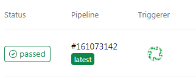

# Bitbucket

> **Aplica-se a:** Syhunt Hybrid 7.2

**Conteúdo**

- [Introdução](#intro)
- [Ativando um runner do Syhunt](#activation)
- [Adicionando o Syhunt ao seu pipeline](#addyml)
- [Funções de varredura e condições de aprovação/reprovação](#dast)
- [Bitbucket Issues](#submitissues)

<a id="intro"></a>

## Introdução

Você pode iniciar varreduras do Syhunt a partir de um arquivo do Bitbucket Pipelines, incluindo o Syhunt Dynamic, o Syhunt Code e o Syhunt Mobile no seu pipeline de entrega contínua. Há suporte a runners no Windows e no Linux.

Os pipelines a seguir fazem a varredura do código-fonte do repositório, reprovam o passo se forem encontradas vulnerabilidades de risco médio ou alto e anexam um relatório de vulnerabilidades aos artefatos do passo.

**Runner Windows:**

```yaml
pipelines:
  default:
    - step:
        runs-on:
          - self.hosted
          - windows
        script:
          - Start-CodeScan -pfcond 'fail-if:risk=mediumup' -output 'report.pdf'
        artifacts:
          - report.pdf
```

**Runner Linux:**

```yaml
pipelines:
  default:
    - step:
        runs-on:
          - self.hosted
          - linux.shell
        script:
          - ${HOME}/syhunt-hybrid/carbon/scancode ${PWD} -pfcond:fail-if:risk=mediumup -rout:${PWD}/report.html
        artifacts:
          - report.html
```

<a id="activation"></a>

## Ativando um runner do Syhunt

O runner do Syhunt é um runner auto-hospedado (self-hosted) do Bitbucket que recebe solicitações de varredura, executa as varreduras e devolve os resultados ao Bitbucket.

> [!IMPORTANT]
> Por segurança e desempenho, instale o runner em uma máquina virtual separada ou em uma máquina física dedicada.

1. Instale o Git com as configurações padrão:
   - **Windows:** [Git for Windows](https://gitforwindows.org/).
   - **Linux:** o pacote `git`, pelo gerenciador de pacotes da sua distribuição.
2. Instale o Syhunt Hybrid com as configurações padrão (`syhunt-hybrid-<versão>.exe` no Windows, `syhunt-hybrid-<versão>.jar` no Linux).
3. Execute `java -version` no Prompt de Comando ou no terminal e verifique se o Java 22.0.2 ou posterior está instalado. Caso contrário, instale o [JDK 22 ou posterior](https://www.oracle.com/java/technologies/downloads/).
4. No Bitbucket, abra o repositório e:
   1. Clique em **Repository settings** na barra lateral esquerda.
   2. Role até **Pipelines** e clique em **Runners**.
   3. Clique em **Add runner**. Em **System and architecture**, selecione **Windows (64-bit)**, ou **Linux Shell** se o Syhunt estiver instalado no Linux.
   4. Dê um nome ao runner (por exemplo, `Syhunt`) e um rótulo (por exemplo, `syhunt`) e clique em **Next**.

   O Bitbucket exibe instruções para baixar o aplicativo do runner e instalá-lo na sua máquina.
5. Siga essas instruções para ativar o runner e clique em **Next**.

O Syhunt já pode ser chamado a partir dos seus pipelines do Bitbucket.

<a id="addyml"></a>

## Adicionando o Syhunt ao seu pipeline

Se o seu repositório ainda não tiver um arquivo de pipeline, crie `bitbucket-pipelines.yml` na raiz.

### SAST

Faz a varredura do código-fonte do repositório, reprova o passo se forem encontradas vulnerabilidades de risco médio ou alto e anexa um relatório aos artefatos do passo.

**Windows:**

```yaml
pipelines:
  default:
    - step:
        runs-on:
          - self.hosted
          - windows
        script:
          - Start-CodeScan -pfcond 'fail-if:risk=mediumup' -output 'report.pdf'
        artifacts:
          - report.pdf
```

**Linux:**

```yaml
pipelines:
  default:
    - step:
        runs-on:
          - self.hosted
          - linux.shell
        script:
          - ${HOME}/syhunt-hybrid/carbon/scancode ${PWD} -pfcond:fail-if:risk=mediumup -rout:${PWD}/report.html
        artifacts:
          - report.html
```

### DAST

Faz a varredura da aplicação web em produção após a implantação, reprova o passo se forem encontradas vulnerabilidades de risco médio ou alto e anexa um relatório aos artefatos do passo.

**Windows:**

```yaml
pipelines:
  default:
    - step:
        runs-on:
          - self.hosted
          - windows
        script:
          - Start-DynamicScan -target 'www.productionurl.com' -pfcond 'medium' -output 'report.pdf'
        artifacts:
          - report.pdf
```

**Linux:**

```yaml
pipelines:
  default:
    - step:
        runs-on:
          - self.hosted
          - linux.shell
        script:
          - ${HOME}/syhunt-hybrid/carbon/scanurl www.productionurl.com -pfcond:fail-if:risk=mediumup -rout:${PWD}/report.html
        artifacts:
          - report.html
```

<a id="dast"></a>
<a id="sast"></a>
<a id="passfail"></a>

## Funções de varredura e condições de aprovação/reprovação

| | Runner Windows | Runner Linux |
|---|---|---|
| Varreduras dinâmicas | [`Start-DynamicScan`](powershell.md#dynamicscan) (PowerShell) | [`scanurl`](command-line.md#cli_dynamic_begin) |
| Varreduras de código | [`Start-CodeScan`](powershell.md#codescan) (PowerShell) | [`scancode`](command-line.md#cli_code_begin) |
| Condições de aprovação/reprovação | [PowerShell](powershell.md#pfcond) | [CLI](command-line.md#pfcond) |

Mais exemplos para Windows estão no [guia de PowerShell](powershell.md#examples).



<a id="submitissues"></a>

## Bitbucket Issues

A integração com o Bitbucket Pipelines já está disponível. A integração com o Bitbucket Issues está prevista para uma versão futura.
