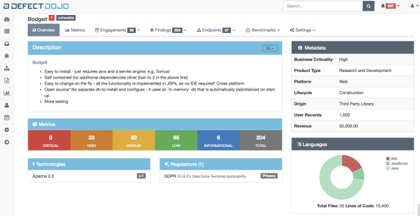

# DefectDojo

> **Aplica-se a:** Syhunt Hybrid 7.2



O [DefectDojo](https://www.defectdojo.org/) automatiza a gestão de vulnerabilidades de segurança de aplicações. Ele agiliza os testes de segurança com recursos como importação de resultados de terceiros, mesclagem e remoção de duplicatas, integração com o Jira, modelos, geração de relatórios e métricas de segurança.

Desde a versão 6.9.17, o Syhunt pode se conectar à API de um servidor DefectDojo e enviar automaticamente resultados de SAST ou DAST. Como alternativa, o Syhunt pode gerar um relatório compatível para importação manual no DefectDojo.

## Envio automático de resultados

**1. Crie um conector do DefectDojo**

1. Clique em **Connectors** no menu superior da interface web.<br>
2. Clique em **Add**. A tela **New Connector** é aberta.
3. Informe um nome para o conector (por exemplo, `MyDefectDojo`).
4. Defina **Type** como **DefectDojo**.
5. Clique em **Create** e, após a mensagem de sucesso, em **Close**.

**2. Configure-o**

1. Clique no conector na lista. A tela de preferências dele é aberta.
2. Informe a URL do servidor DefectDojo, por exemplo `https://<IP>/`.
3. Informe seu token de API.
4. Clique em **Save**.

**3. Teste-o**

Clique no conector na lista e escolha **Run Test**. Se tudo estiver configurado corretamente, uma varredura de teste aparece em `https://<servidor>/engagement/active`. Caso contrário, uma mensagem de erro indica o que corrigir.

**4. Associe-o às suas varreduras**

- **CLI:** informe `-tk:<nomedoconector>`.
- **Varreduras agendadas:** nas preferências da varredura agendada, na aba **Notifications**, selecione o conector em **Issue Tracker #1** ou **#2**.

### Criando o conector pela CLI

```lua
-- Adicionar um rastreador do DefectDojo
scancore -tracker:add
-- Informe o tipo (DefectDojo) e um nome para o rastreador e pressione Enter.

-- Configurá-lo
scancore -tracker:set to:mytrackername -key:api.url -v:"https://serverurl/"
scancore -tracker:set to:mytrackername -key:auth.token.encrypted -vsecret

-- Testá-lo
scancore -tracker:send -tid:TEST -to:mytrackername

-- Configurações opcionais
scancore -tracker:set to:mytrackername -key:scan.minseverity -v:Info
scancore -tracker:set to:mytrackername -key:scan.testtitle -v:"Syhunt Scan"
scancore -tracker:set to:mytrackername -key:scan.engagementname -v:"Syhunt Hybrid Scan"
scancore -tracker:set to:mytrackername -key:scan.producttypename -v:"Research and Development"
scancore -tracker:set to:mytrackername -key:scan.productname -v:Syhunt
scancore -tracker:set to:mytrackername -key:scan.autocreatecontext -v:true
scancore -tracker:set to:mytrackername -key:scan.active -v:true
scancore -tracker:set to:mytrackername -key:scan.verified -v:true
scancore -tracker:set to:mytrackername -key:scan.closeoldfindings -v:false
scancore -tracker:set to:mytrackername -key:scan.skipduplicates -v:false
scancore -tracker:set to:mytrackername -key:scan.pushtojira -v:false
```

Em seguida, informe o rastreador ao PowerShell ou à CLI:

```powershell
# PowerShell: rastreador existente com as configurações salvas
Start-CodeScan -pfcond "medium" -tracker "mytrackername"

# PowerShell: rastreador existente, alterando configurações apenas nesta execução
Start-CodeScan -pfcond "medium" -tracker "mytrackername?productname=Syhunt###autocreatecontext=true"

# PowerShell: rastreador definido na hora
Start-CodeScan -pfcond "medium" -tracker "?app=defectdojo###apiurl=https://serverurl/###token=YOURTOKEN###productname=Syhunt###testtitle=Syhunt Scan###autocreatecontext=true"
```

Pela CLI, use `-tk` em vez de `-tracker`:

```
scancode <alvo> -pfcond:medium -tk:"mydefectdojotrackername?productname=Syhunt###autocreatecontext=true"
```

> [!NOTE]
> Em `-tk` e `-tracker`, as preferências devem usar seus [nomes abreviados](issue-trackers.md#shortnames).

## Gerando um relatório compatível

Para importar os resultados manualmente, faça o Syhunt gerar um relatório compatível com o DefectDojo dando ao arquivo de exportação a extensão dupla `.sast.json` ou `.dast.json`. Ao importar o arquivo no DefectDojo, escolha o formato **GitLab SAST** ou **GitLab DAST**.

| Varredura | Exemplo |
|---|---|
| SAST | `scancode <alvo> -xout:qualquernome.sast.json` |
| DAST | `scanurl <alvo> -xout:qualquernome.dast.json` |

- **GitHub, GitLab e PowerShell:** informe o nome do arquivo no parâmetro `outputex` da função de varredura.
- **Jenkins:** informe o nome do arquivo no parâmetro `outFilename` da função de varredura.

> [!NOTE]
> Atualmente, o DefectDojo documenta apenas o suporte ao GitLab SAST. A importação de DAST pode ter [algumas limitações](https://github.com/DefectDojo/django-DefectDojo/issues/5863).
