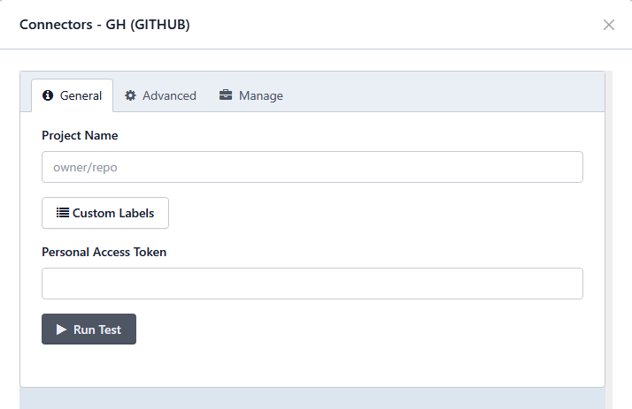

# GitHub

> **Aplica-se a:** Syhunt Hybrid 7.2

**Conteúdo**

- [Introdução](#intro)
- [Ativando um runner do Syhunt](#activation)
- [Adicionando o Syhunt a um workflow](#addyml)
- [Funções de varredura e condições de aprovação/reprovação](#dast)
- [Enviando vulnerabilidades ao GitHub Issues](#submitissues)

<a id="intro"></a>

## Introdução

Você pode iniciar varreduras do Syhunt a partir de um workflow do GitHub Actions, incluindo o Syhunt Dynamic, o Syhunt Code e o Syhunt Mobile no seu pipeline de entrega contínua. Também pode configurar o GitHub como rastreador de issues no Syhunt, para que as vulnerabilidades sejam enviadas às Issues de um projeto.

O workflow a seguir faz a varredura do código-fonte do repositório, reprova o job se forem encontradas vulnerabilidades de risco médio ou alto e anexa um relatório de vulnerabilidades em PDF aos artefatos do job:

```yaml
name: syhunt test
on:
  push:
    branches:
      - main
jobs:
  build:
    runs-on: [self-hosted, Windows, X64]
    steps:
      - uses: actions/checkout@v2
      - run: Start-CodeScan -pfcond 'medium' -output 'report.pdf'
      - name: 'Syhunt Report'
        uses: actions/upload-artifact@v2
        if: failure()
        with:
          name: syhunt-report
          path: report.pdf
          if-no-files-found: error
```

<a id="activation"></a>

## Ativando um runner do Syhunt

O runner do Syhunt é um runner auto-hospedado (self-hosted) do GitHub Actions que recebe solicitações de varredura, executa as varreduras e devolve os resultados ao GitHub.

> [!IMPORTANT]
> Por segurança e desempenho, instale o runner em uma máquina virtual separada ou em uma máquina física dedicada.

1. Instale o [Git for Windows](https://gitforwindows.org/) com as configurações padrão.
2. Instale o Syhunt Hybrid (`syhunt-hybrid-<versão>.exe`) com as configurações padrão.
3. No GitHub, abra a página principal do repositório e:
   1. Clique em **Settings**.
   2. Na barra lateral esquerda, clique em **Actions** e depois em **Runners**.
   3. Clique em **New self-hosted runner**.
   4. Selecione o sistema operacional **Windows** e a arquitetura **x64**.

   O GitHub exibe instruções para baixar o aplicativo do runner e instalá-lo na sua máquina.
4. Siga essas instruções para registrar o runner com o token do repositório. Ao executar `config.cmd`:
   1. Pressione **Enter** para adicionar o runner ao grupo Default.
   2. Informe um nome para o runner, por exemplo `syhunt`.
   3. Informe um rótulo para o runner, por exemplo `syhunt`.
   4. As mensagens **√ Runner successfully added** e **√ Runner connection is good** confirmam o sucesso.
   5. Pressione **Enter** para manter `_work` como pasta de trabalho.
   6. Escolha se o runner será executado como serviço do Windows.
5. Execute `run.cmd`. Você verá:
   ```
   √ Connected to GitHub
   2022-02-04 19:50:21Z: Listening for Jobs
   ```

O Syhunt já pode ser chamado a partir de workflows do GitHub Actions.

> [!NOTE]
> O GitHub remove automaticamente um runner auto-hospedado que fica mais de 30 dias sem se conectar ao GitHub Actions. Além disso, cada execução de workflow é limitada a 72 horas; execuções que atingem esse limite são canceladas.

<a id="addyml"></a>

## Adicionando o Syhunt a um workflow

Se o seu repositório ainda não tiver um arquivo de workflow, crie um, por exemplo `.github/workflows/syhunt.yml`.

**Exemplo de SAST:** faz a varredura do código-fonte do repositório, reprova o job se forem encontradas vulnerabilidades de risco médio ou alto e anexa um relatório em PDF aos artefatos do job:

```yaml
name: syhunt test
on:
  push:
    branches:
      - main
jobs:
  build:
    runs-on: [self-hosted, Windows, X64]
    steps:
      - uses: actions/checkout@v2
      - run: Start-CodeScan -pfcond 'medium' -output 'report.pdf'
      - name: 'Syhunt Report'
        uses: actions/upload-artifact@v2
        if: failure()
        with:
          name: syhunt-report
          path: report.pdf
          if-no-files-found: error
```

**Exemplo de DAST:** faz a varredura da aplicação web em produção após a implantação, reprova o job se forem encontradas vulnerabilidades de risco médio ou alto e anexa um relatório em PDF aos artefatos do job:

```yaml
name: syhunt test
on:
  push:
    branches:
      - main
jobs:
  build:
    runs-on: [self-hosted, Windows, X64]
    steps:
      - uses: actions/checkout@v2
      - run: Start-DynamicScan -target 'www.productionurl.com' -pfcond 'medium' -output 'report.pdf'
      - name: 'Syhunt Report'
        uses: actions/upload-artifact@v2
        if: failure()
        with:
          name: syhunt-report
          path: report.pdf
          if-no-files-found: error
```

<a id="dast"></a>
<a id="sast"></a>
<a id="passfail"></a>

## Funções de varredura e condições de aprovação/reprovação

Os passos do workflow chamam as funções PowerShell do Syhunt. Consulte o guia de PowerShell para ver todos os parâmetros e mais exemplos:

- [`Start-DynamicScan`](powershell.md#dynamicscan)
- [`Start-CodeScan`](powershell.md#codescan)
- [Mais exemplos](powershell.md#examples)
- [Condições de aprovação/reprovação](powershell.md#pfcond)


<a id="submitissues"></a>

## Enviando vulnerabilidades ao GitHub Issues

Com um rastreador de issues do GitHub configurado, você pode enviar uma vulnerabilidade a um projeto com um clique.



Consulte [Rastreadores de Issues: GitHub](issue-trackers.md#tracker_github) para configurar o rastreador e [Enviando vulnerabilidades a um rastreador](issue-trackers.md#tracker_submit) para saber como enviar os resultados.
