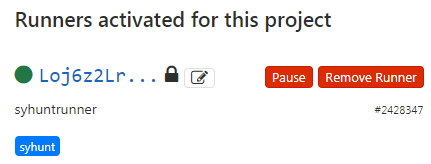

# GitLab

> **Aplica-se a:** Syhunt Hybrid 7.2

**Conteúdo**

- [Introdução](#intro)
- [Ativando um runner do Syhunt](#gitlabrunner)
- [Adicionando o Syhunt ao seu arquivo de CI](#addyml)
- [Painel de segurança do GitLab](#dashboard)
- [Funções de varredura e condições de aprovação/reprovação](#dast)
- [Configurações avançadas do runner](#advancedsettings)
- [Enviando vulnerabilidades ao GitLab Issues](#submitissues)

<a id="intro"></a>

## Introdução

Você pode iniciar varreduras do Syhunt a partir de um pipeline do GitLab CI, incluindo o Syhunt Dynamic, o Syhunt Code e o Syhunt Mobile no seu pipeline de entrega contínua e no painel de segurança, agendar varreduras e muito mais. Também pode configurar o GitLab como rastreador de issues no Syhunt, para que as vulnerabilidades sejam enviadas às Issues de um projeto.


O job a seguir faz a varredura do código-fonte do repositório, é reprovado se forem encontradas vulnerabilidades de risco médio ou alto, anexa um relatório em PDF aos artefatos do job e adiciona os resultados ao painel de segurança do GitLab:

```yaml
syhunt_test:
  script:
    - Start-CodeScan -pfcond 'medium' -output 'report.pdf' -outputex 'gl-sast-report.json'
  artifacts:
    reports:
      sast: gl-sast-report.json
    paths:
      - report.pdf
    when: on_failure
  tags:
    - syhunt
```

<a id="gitlabrunner"></a>

## Ativando um runner do Syhunt

O runner do Syhunt é um serviço de CI que recebe solicitações de varredura, executa as varreduras e devolve os resultados ao GitLab.

> [!IMPORTANT]
> Por segurança e desempenho, instale o runner em uma máquina virtual separada ou em uma máquina física dedicada.

1. No seu projeto do GitLab, obtenha um token de registro de runner:
   1. Clique em **Settings → CI/CD**.
   2. Expanda **Runners**.
   3. Role até **Set up a specific Runner manually**.
   4. Copie o token de registro e guarde-o em local seguro; você vai precisar dele em seguida.
2. Instale o [Git for Windows](https://gitforwindows.org/) com as configurações padrão.
3. Instale o Syhunt Hybrid (`syhunt-hybrid-<versão>.exe`) com as configurações padrão.
4. Baixe e execute o instalador do Syhunt Runner. Quando forem solicitados os dados de registro do runner, cole o token de registro, clique em **Next** e conclua a instalação.

Volte à seção **Runners** no GitLab e atualize a página (F5). O `syhuntrunner` deve aparecer em **Runners activated for this project**:



O Syhunt já pode ser chamado a partir do seu pipeline de CI.

<a id="addyml"></a>

## Adicionando o Syhunt ao seu arquivo de CI

Se o seu repositório ainda não tiver um arquivo de CI, vá em **Project overview** e clique em **Set up CI/CD**. Isso cria um arquivo `.gitlab-ci.yml` no repositório.

**Exemplo de SAST:** faz a varredura do código-fonte do repositório, é reprovado se forem encontradas vulnerabilidades de risco médio ou alto, anexa um relatório em PDF aos artefatos do job e adiciona os resultados ao painel de segurança:

```yaml
syhunt_test:
  stage: test
  script:
    - Start-CodeScan -pfcond 'medium' -output 'report.pdf' -outputex 'gl-sast-report.json'
  artifacts:
    reports:
      sast: gl-sast-report.json
    paths:
      - report.pdf
    when: on_failure
  tags:
    - syhunt
```

**Exemplo de DAST:** faz a varredura da aplicação web em produção após a implantação, é reprovado se forem encontradas vulnerabilidades de risco médio ou alto, anexa um relatório em PDF aos artefatos do job e adiciona os resultados ao painel de segurança:

```yaml
production:
  stage: deploy
  script:
    - Start-DynamicScan -target 'www.productionurl.com' -pfcond 'medium' -output 'report.pdf' -outputex 'gl-dast-report.json'
  artifacts:
    reports:
      dast: gl-dast-report.json
    paths:
      - report.pdf
    when: on_failure
  tags:
    - syhunt
  only:
    - tags
```

Para mais exemplos, consulte o [guia de PowerShell](powershell.md#examples).

<a id="dashboard"></a>

## Painel de segurança do GitLab

O Syhunt gera um relatório de vulnerabilidades compatível com o GitLab quando o nome do arquivo em `-outputex` é:

- **SAST:** `gl-sast-report.json` ou `<qualquernome>.gls.json`
- **DAST:** `gl-dast-report.json` ou `<qualquernome>.gld.json`

Para ativar a integração, adicione também o arquivo em `artifacts.reports.sast` ou `artifacts.reports.dast` no seu arquivo de CI, como nos exemplos acima.

**Como o GitLab exibe os resultados**

- Atualmente, o GitLab adiciona ao painel de segurança e ao relatório de vulnerabilidades de um projeto apenas os pipelines **bem-sucedidos**. Para ver todos os resultados ali, omita o `-pfcond` no passo do Syhunt. Como alternativa, com a condição de aprovação/reprovação `high`, se não forem encontradas vulnerabilidades de risco alto, todos os resultados de risco médio a informativo aparecem no painel.
- A aba **Security** do pipeline sempre lista todas as vulnerabilidades, seja o pipeline bem-sucedido ou não. Porém, se o pipeline falhar porque uma condição de aprovação/reprovação foi atendida, o GitLab pode mostrar, de forma inconsistente, uma contagem de 0 vulnerabilidades e ainda assim listá-las. Este é um [problema conhecido do GitLab](https://gitlab.com/gitlab-org/gitlab/-/issues/352157).

> [!TIP]
> Se esta for a primeira varredura de um código **grande**, faça uma varredura sem a integração com o painel para ver quantas vulnerabilidades existem. Se houver muitas, corrija o primeiro lote relatado pelo Syhunt para melhorar a segurança da aplicação e só então ative a integração com o painel.

<a id="dast"></a>
<a id="sast"></a>
<a id="passfail"></a>

## Funções de varredura e condições de aprovação/reprovação

Os jobs de CI chamam as funções PowerShell do Syhunt. Consulte o guia de PowerShell para ver todos os parâmetros:

- [`Start-DynamicScan`](powershell.md#dynamicscan)
- [`Start-CodeScan`](powershell.md#codescan)
- [Condições de aprovação/reprovação](powershell.md#pfcond)


<a id="advancedsettings"></a>

## Configurações avançadas do runner

Para permitir que o runner processe vários jobs ao mesmo tempo, aumente o valor de `concurrent` em `C:\SyhuntRunner\config.toml`. Consulte a documentação de [configuração avançada](https://docs.gitlab.com/runner/configuration/advanced-configuration.html) do GitLab.

<a id="submitissues"></a>

## Enviando vulnerabilidades ao GitLab Issues

Com um rastreador de issues do GitLab configurado, você pode enviar uma vulnerabilidade a um projeto com um clique.


Consulte [Rastreadores de Issues: GitLab](issue-trackers.md#tracker_gitlab) para configurar o rastreador e [Enviando vulnerabilidades a um rastreador](issue-trackers.md#tracker_submit) para saber como enviar os resultados.
