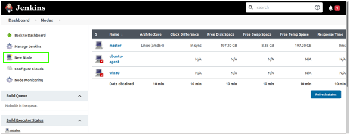
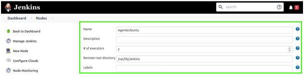
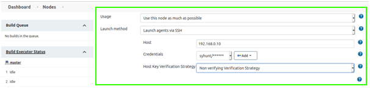

# Jenkins

> **Aplica-se a:** Syhunt Hybrid 7.2

**Conteúdo**

- [Introdução](#intro)
- [Ativando um agente do Syhunt](#agents)
- [Antes de instalar o Syhunt (Windows)](#preinstall_win)
- [Antes de instalar o Syhunt (Linux)](#preinstall_linux)
- [Adicionando o Syhunt a um pipeline](#pipeline_integration)
- [Função `scanURL`](#scanurl)
- [Função `scanCode`](#scancode)
- [Condições de aprovação/reprovação](#pfcond)
- [Agendamento de varreduras](#sched)

<a id="intro"></a>

## Introdução

Você pode executar varreduras do Syhunt a partir de um script de pipeline do Jenkins, incluindo o Syhunt Dynamic, o Syhunt Code e o Syhunt Mobile no seu pipeline de entrega contínua, agendar varreduras e muito mais.

### Onde instalar o Syhunt

O Syhunt pode ser instalado:

1. **Na própria máquina do Jenkins**, de modo que o Syhunt e o servidor Jenkins rodem lado a lado; ou
2. **Em uma máquina separada que atua como agente do Jenkins**, chamada remotamente via SSH pelo servidor Jenkins principal.

Usar agentes de CI é uma boa prática comum em ambientes DevOps, por isso recomendamos fortemente a segunda opção. Por segurança e desempenho, ambientes de produção também devem usar uma máquina dedicada como agente.

No Windows ou no Linux, **instale o Syhunt depois que o Jenkins estiver implantado e configurado**. Assim, o instalador do Syhunt detecta o Jenkins e instala automaticamente as extensões necessárias. Se você instalou o Syhunt primeiro, basta executar o instalador do Syhunt novamente.

Lembre-se de que o Syhunt é licenciado por dispositivo: cada máquina agente precisa de sua própria licença.

<a id="agents"></a>

## Ativando um agente do Syhunt

Com as instalações principal (controlador) e agente do Jenkins implantadas e configuradas, disponibilize o agente para o controlador:

1. No painel do Jenkins do controlador, clique em **Manage Jenkins** na barra lateral.<br>
2. Em **System Configuration**, clique em **Manage Nodes and Clouds**.<br>
3. Na tela **Nodes**, clique em **New Node** na barra lateral.<br>
   1. Dê um nome ao nó.<br>
   2. Selecione **Permanent Agent** e clique em **OK**.
   3. Defina **# of executors** como **2**.<br>
   4. Defina **Remote root directory** como a pasta do Jenkins no agente: `/var/lib/jenkins` no Linux. No Windows, use a pasta `.jenkins`, normalmente `C:\Users\<seuusuário>\.jenkins` ou `C:\windows\system32\config\systemprofile\AppData\Local\Jenkins\.jenkins`; verifique qual delas existe no agente.
   5. Dê ao nó um rótulo que será usado depois para referenciá-lo, por exemplo `Syhunt`.
   6. Mantenha **Usage** no valor padrão.<br>
   7. Defina **Launch method** como **Launch agents via SSH**.
   8. Informe o nome de host ou o endereço IP da máquina agente.
   9. Em **Credentials**, clique em **Add** e informe o usuário e a senha do usuário Jenkins do agente.
   10. Defina a **Host Key Verification Strategy**:
       - Se você não tiver uma credencial SSH, use **Non verifying Verification Strategy**.<br>
       - Se você criou uma credencial SSH do Jenkins no agente, conforme a [documentação do Jenkins](https://www.jenkins.io/doc/book/using/using-agents/), use **Manually provided key Verification Strategy**. Recomenda-se usar uma estratégia de verificação para mais segurança, principalmente em produção.
   11. Mantenha **Availability** no valor padrão.
   12. Clique em **Save**.
4. Se ainda não o fez, instale o Syhunt na máquina agente, conforme descrito abaixo.

<a id="preinstall_win"></a>

## Antes de instalar o Syhunt (Windows)

Depois de implantar e configurar o Jenkins:

1. Se for usar `scanCode()` para fazer a varredura de URLs Git, instale o [Git for Windows](https://gitforwindows.org/).
2. Instale o Syhunt conforme descrito no [guia de instalação](../installation/install-windows.md).

<a id="preinstall_linux"></a>

## Antes de instalar o Syhunt (Linux)

Depois de implantar e configurar o Jenkins, altere o usuário do Jenkins para o seu usuário atual (desde que não seja o `root`) ou para outro usuário de sua escolha. Não recomendamos executar o Jenkins como `root`, o que poderia expor o sistema operacional e os repositórios do Jenkins.

1. Edite o arquivo de configuração do Jenkins:
   - CentOS: `sudo vi /etc/sysconfig/jenkins`
   - Ubuntu: `sudo vi /etc/default/jenkins`
2. Altere `JENKINS_USER="jenkins"` para `JENKINS_USER="usuariodesuaescolha"`.
3. Torne o novo usuário dono das principais pastas do Jenkins:
   ```bash
   sudo chown -R usuariodesuaescolha:usuariodesuaescolha /var/lib/jenkins
   sudo chown -R usuariodesuaescolha:usuariodesuaescolha /var/log/jenkins
   sudo chown -R usuariodesuaescolha:usuariodesuaescolha /var/cache/jenkins
   ```
4. Reinicie o Jenkins:
   ```bash
   sudo systemctl restart jenkins
   ```
5. Conectado com esse usuário, instale o Syhunt conforme descrito no [guia de instalação para Linux](../installation/install-linux.md). Se for usar `scanCode()` para fazer a varredura de URLs Git, instale também o Git (também explicado ali).

<a id="pipeline_integration"></a>

## Adicionando o Syhunt a um pipeline

1. No painel do Jenkins, abra o pipeline.
2. Clique em **Configure** na barra lateral.
3. Na aba **Pipeline**, desmarque **Use Groovy Sandbox**, se estiver marcado.
4. Adicione um código como este no ponto adequado do seu script de pipeline:

   ```groovy
   def rootDir = pwd()
   def syhunt = load "${rootDir}/../workspace@script/syhunt/syhunt.groovy"
   syhunt.scanURL([target: 'http://somewebsite.com/', huntMethod: 'appscan', pfcond: 'fail-if:risk=mediumup'])
   ```

   Um exemplo completo:

   ```groovy
   #!/usr/bin/env groovy

   // Se não estiver usando um agente, altere a próxima linha para apenas: node {
   node ("Syhunt") {
       stage('Scan') {
           def rootDir = pwd()
           def syhunt = load "${rootDir}/../workspace@script/syhunt/syhunt.groovy"
           syhunt.scanURL([target: 'http://somewebsite.com/', huntMethod: 'appscan', pfcond: 'fail-if:risk=mediumup'])
       }
   }
   ```
5. Clique em **Save**.

### Executando o build

Quando o pipeline for executado, a saída do console será parecida com esta:

```
[Pipeline] echo
Preparing to scan URL: http://somewebsite.com/
[Pipeline] echo
VULNERABLE!
Found 2 vulnerabilities
SYHUNT URLSCAN 6.8.5.4 PLATINUM EDITION (c) 2020 Syhunt
...
[Pipeline] echo
Build problem: found Medium risk vulnerabilities.
[Pipeline] }
[Pipeline] // stage
[Pipeline] }
[Pipeline] // node
[Pipeline] End of Pipeline
Finished: FAILURE
```

<a id="scanurl"></a>

## Função `scanURL`

Inicia uma varredura do Syhunt Dynamic.

| Parâmetro | Descrição |
|---|---|
| `target` **(obrigatório)** | A URL a ser verificada, por exemplo `http://www.somesite.com`. |
| `huntMethod` | O [método de varredura](../scanning/hunt-methods.md) a ser usado. Se omitido, é usado o método padrão. |
| `pfcond` | Reprova o build quando uma [condição de aprovação/reprovação](#pfcond) é atendida. |
| `timelimit` | Tempo máximo da varredura, por exemplo `1d`, `3h`, `2h30m`, `50m`. A varredura é interrompida ao atingir o limite. Sem limite por padrão. |

Retorna um mapa com:

| Chave | Descrição |
|---|---|
| `outFilename` | O nome do arquivo do relatório gerado. |
| `outResultHTML` | O conteúdo do relatório gerado, como texto HTML. |

<a id="scancode"></a>

## Função `scanCode`

Inicia uma varredura do Syhunt Code.

| Parâmetro | Descrição |
|---|---|
| `target` **(obrigatório)** | A URL de um repositório, ou uma pasta ou arquivo de código-fonte local. |
| `huntMethod` | O [método de varredura](../scanning/hunt-methods.md) a ser usado. Se omitido, é usado o método padrão. |
| `pfcond` | Reprova o build quando uma [condição de aprovação/reprovação](#pfcond) é atendida. |
| `branch` | O branch Git a ser verificado. Se omitido, o cliente Git obtém o branch padrão. Desnecessário para pastas ou arquivos locais. |
| `timelimit` | Tempo máximo da varredura, por exemplo `1d`, `3h`, `2h30m`, `50m`. Sem limite por padrão. |

Retorna o mesmo mapa que `scanURL()`.

```groovy
syhunt.scanCode([target: 'https://github.com/someuser/somerepo.git', huntMethod: 'normal', pfcond: 'fail-if:risk=mediumup'])
syhunt.scanCode([target: 'C:\\www\\', huntMethod: 'normal', pfcond: 'fail-if:risk=mediumup'])
```

<a id="pfcond"></a>

## Condições de aprovação/reprovação

| Condição | Reprova se… |
|---|---|
| `high` ou `fail-if:risk=high` | for encontrada uma vulnerabilidade ou ameaça de risco Alto. |
| `medium` ou `fail-if:risk=mediumup` | for encontrada uma vulnerabilidade ou ameaça de risco Médio ou Alto. |
| `low` ou `fail-if:risk=lowup` | for encontrada uma vulnerabilidade ou ameaça de risco Baixo, Médio ou Alto. |

<a id="sched"></a>
<a id="sched_begin"></a>

## Agendamento de varreduras

1. No painel do Jenkins, abra o pipeline.
2. Clique em **Configure** na barra lateral.
3. Na aba **Build Triggers**, selecione **Build periodically** e informe o agendamento.
4. Clique em **Save**.

<a id="sched_end"></a>
