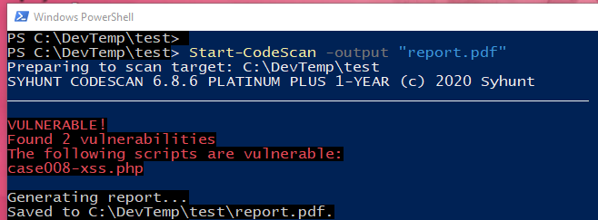

# PowerShell

> **Aplica-se a:** Syhunt Hybrid 6.9.17

Você pode executar varreduras do Syhunt a partir de scripts PowerShell, o que facilita incluir o Syhunt Dynamic, o Syhunt Code e o Syhunt Mobile no seu pipeline de entrega contínua e em outras automações. O instalador do Syhunt Hybrid adiciona um **módulo PowerShell do Syhunt** no Windows, com funções para iniciar varreduras, obter relatórios e resultados e realizar testes de aprovação/reprovação.



## Adicionando o Syhunt a um script

Insira um código como este no ponto adequado do seu script PowerShell:

<a id="examples"></a>

```powershell
# SAST: varredura da pasta/repositório atual
Start-CodeScan -pfcond "medium"

# SAST: varredura de um repositório remoto
$MyProject = @{
  target = 'https://github.com/syhunt/vulnphp.git';
  branch = 'main';
  pfcond = 'medium';
  output = 'report.pdf'
}
Start-CodeScan @MyProject

# DAST: varredura de uma URL
$MyWebsite = @{
  target = 'https://www.somewebsite.com';
  pfcond = 'medium';
  output = 'report.pdf'
}
Start-DynamicScan @MyWebsite
```

<a id="examplesend"></a>
<a id="dynamicscan"></a>

## `Start-DynamicScan`

Inicia uma varredura do Syhunt Dynamic.

| Parâmetro | Descrição |
|---|---|
| `target` **(obrigatório)** | A URL a ser verificada, por exemplo `http://www.somesite.com`. |
| `huntmethod` | O [método de varredura](../scanning/hunt-methods.md) a ser usado. Se omitido, é usado o método padrão. |
| `pfcond` | Faz o script terminar com código de falha quando uma condição é atendida. Consulte [Condições de aprovação/reprovação](#pfcond). |
| `tracker` | O nome de um rastreador existente, ou um rastreador definido na hora, que receberá um resumo das vulnerabilidades encontradas. Consulte os [exemplos](issue-trackers.md#tracker_submit). |
| `output` | Nome do arquivo de saída, por exemplo `report.pdf` ou `report.html`. |
| `outputex` | Nome de um segundo arquivo de saída, por exemplo `export.json`. |
| `verbmode` | `$false` por padrão. Defina como `$true` para uma saída detalhada (além de erros e informações básicas). |
| `genrep` | `$true` por padrão. Defina como `$false` para não gerar arquivo de saída. |
| `redirIO` | `$true` por padrão. Defina como `$false` para não redirecionar a entrada e a saída do scanner para o console. |
| `timelimit` | Tempo máximo da varredura, por exemplo `1d`, `3h`, `2h30m`, `50m`. A varredura é interrompida ao atingir o limite. Sem limite por padrão. |

`output` e `outputex` aceitam todos os formatos de saída suportados pelo Syhunt. Os arquivos são salvos na pasta de trabalho atual, a menos que você informe o caminho completo.

```powershell
# Exemplo 1: em uma linha
Start-DynamicScan -target 'https://www.somewebsite.com' -pfcond 'fail-if:risk=mediumup'

# Exemplo 2: parâmetros em uma hashtable
$MyWebsite = @{
  target = 'https://www.somewebsite.com';
  pfcond = 'medium';
  output = 'report.pdf'
}
Start-DynamicScan @MyWebsite
```

<a id="dynamicscanend"></a>
<a id="codescan"></a>

## `Start-CodeScan`

Inicia uma varredura do Syhunt Code. Todos os parâmetros são opcionais.

| Parâmetro | Descrição |
|---|---|
| `target` | A URL de um repositório, ou uma pasta ou arquivo de código-fonte local. Se omitido, é feita a varredura da pasta de trabalho atual. |
| `branch` | O branch a ser verificado. Se omitido, o cliente Git obtém o branch padrão. |
| `huntmethod` | O [método de varredura](../scanning/hunt-methods.md) a ser usado. Se omitido, é usado o método padrão. |
| `pfcond` | Faz o script terminar com código de falha quando uma condição é atendida. Consulte [Condições de aprovação/reprovação](#pfcond). |
| `tracker` | O nome de um rastreador existente, ou um rastreador definido na hora, que receberá um resumo das vulnerabilidades encontradas. Consulte os [exemplos](issue-trackers.md#tracker_submit). |
| `output` | Nome do arquivo de saída, por exemplo `report.pdf` ou `report.html`. |
| `outputex` | Nome de um segundo arquivo de saída, por exemplo `export.json`. |
| `verbmode` | `$false` por padrão. Defina como `$true` para uma saída detalhada. |
| `genrep` | `$true` por padrão. Defina como `$false` para não gerar arquivo de saída. |
| `redirIO` | `$true` por padrão. Defina como `$false` para não redirecionar a entrada e a saída do scanner para o console. |
| `timelimit` | Tempo máximo da varredura, por exemplo `1d`, `3h`, `2h30m`, `50m`. Sem limite por padrão. |

```powershell
# Exemplo 1: varredura da pasta/repositório atual
Start-CodeScan -pfcond "medium"

# Exemplo 2: varredura de um repositório Git remoto
Start-CodeScan -target "https://github.com/someuser/somerepo.git" -huntmethod "normal" -pfcond "medium"

# Exemplo 3: varredura de um projeto do Azure DevOps Services
Start-CodeScan -target "https://dev.azure.com/user/projectname" -huntmethod "normal" -pfcond "medium"

# Exemplo 4: varredura de uma pasta local específica
Start-CodeScan -target "C:\www\" -huntmethod "normal" -pfcond "medium"
```

<a id="codescanend"></a>
<a id="pfcond"></a>

## Condições de aprovação/reprovação

| Condição | Reprova se… |
|---|---|
| `high` ou `fail-if:risk=high` | for encontrada uma vulnerabilidade ou ameaça de risco Alto. |
| `medium` ou `fail-if:risk=mediumup` | for encontrada uma vulnerabilidade ou ameaça de risco Médio ou Alto. |
| `low` ou `fail-if:risk=lowup` | for encontrada uma vulnerabilidade ou ameaça de risco Baixo, Médio ou Alto. |

## Solução de problemas

**"Script.ps1 cannot be loaded because running scripts is disabled on this system"**

Abra o PowerShell como administrador e permita a execução de scripts:

```powershell
Set-ExecutionPolicy RemoteSigned
```

**"The term 'Start-CodeScan' is not recognized…"**

O módulo do Syhunt não está carregado. Execute `Import-Module Syhunt` e chame a função novamente.

<a id="autoload"></a>

## Carregando o módulo automaticamente

No Windows 10 e posteriores, o módulo do Syhunt é carregado automaticamente.

No Windows 7, execute `Import-Module Syhunt` antes de chamar as funções do Syhunt, ou adicione-o ao seu perfil do PowerShell para que seja carregado sempre:

1. Vá até a pasta do seu perfil do PowerShell. Por padrão, o perfil fica em:
   ```
   C:\Documents and Settings\User\My Documents\WindowsPowerShell\Microsoft.PowerShell_profile.ps1
   ```
2. Crie o arquivo `Microsoft.PowerShell_profile.ps1`.
3. Adicione a linha `Import-Module Syhunt` e salve o arquivo.
