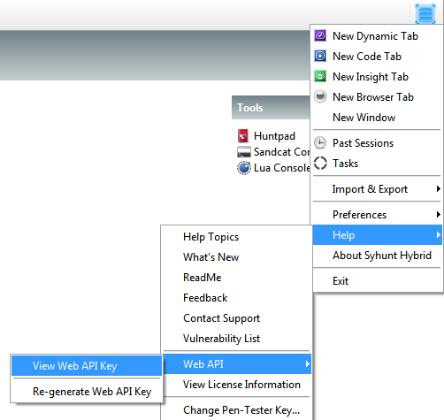

# API Web

> **Aplica-se a:** Syhunt Hybrid 6.9.8.2

**Conteúdo**

- [Introdução](#wapi_intro_begin)
- [Iniciando uma varredura dinâmica](#wapi_dynamic_begin)
- [Iniciando uma varredura de código-fonte](#wapi_code_begin)
- [Obtendo resultados](#wapi_getresults_begin)

<a id="wapi_intro_begin"></a>

## Introdução

O Syhunt Hybrid Platinum inclui uma API web simples para iniciar varreduras dinâmicas e de código-fonte e obter o status, o relatório e o log de uma sessão de varredura. As requisições são do tipo `POST` com corpo JSON, e as respostas são em JSON, exceto quando você solicita um relatório, que é retornado em XML ou JSON.

As mesmas operações estão disponíveis em Lua; consulte a [API Lua](lua-api.md).

### Antes de começar

Certifique-se de que o servidor da API do Syhunt está em execução e de que você tem uma chave de API.

- **Linux:** inicie o servidor da API com `scancore -apisignal:start` e gere uma chave de API com `scancore -apikeygen`.
- **Windows:** na pasta de instalação do Syhunt (normalmente `C:\Program Files\Syhunt Hybrid\`), abra a subpasta `Server` e clique duas vezes no executável `nginx` para iniciar o servidor. Para obter uma chave de API, abra o Syhunt Hybrid e escolha **Help → View Web API Key**.

  

Em seguida, abra `http://localhost:8017/` e verifique se aparece a página padrão do NGINX. A API fica disponível em:

- `http://<host>:8017/syhunt/launch.lua`
- `http://<host>:8017/syhunt/results.lua`

Toda requisição a esses endpoints deve incluir uma chave de API válida no corpo (`apikey`).

<a id="wapi_dynamic_begin"></a>

## Iniciando uma varredura dinâmica

**Endpoint:** `POST /syhunt/launch.lua`

```json
{
  "sessionname": "Test",
  "starturl": "http://127.0.0.1",
  "huntmethod": "appscan",
  "reporttemplate": "Complete",
  "apikey": "YOUR_API_KEY"
}
```

| Chave | Descrição |
|---|---|
| `starturl` **(obrigatória)** | A URL alvo. |
| `apikey` **(obrigatória)** | Sua chave da API web do Syhunt (consulte [Antes de começar](#wapi_intro_begin)). |
| `sessionname` | Um nome de sessão único e alfanumérico. Se omitido, um nome aleatório é gerado. |
| `huntmethod` | Um nome de [método de varredura](../scanning/hunt-methods.md) válido. |
| `reporttemplate` | Um modelo de relatório: `Standard`, `Comparison`, `Compliance` ou `Complete`. |
| `reportgl` | Se `true`, retorna saída JSON no formato do GitLab. |
| `timelimit` | Tempo máximo da varredura, por exemplo `1d`, `3h`, `2h30m`, `50m`. A varredura é interrompida ao atingir o limite. Sem limite por padrão. |

**Resposta:**

```json
{
  "huntmethod": "appscan",
  "pid": 5108,
  "result": true,
  "resultstr": "",
  "sessionname": "Test",
  "sessiontype": "dynamic"
}
```

<a id="launchresponse"></a>

| Chave | Descrição |
|---|---|
| `pid` | Um ID de processo único da varredura em execução. |
| `result` | `true` se a varredura foi iniciada; `false` se não foi possível iniciá-la. |
| `resultstr` | Se `result` for `false`, uma descrição do erro. |
| `sessionname` | O nome da sessão da varredura. Se você não informou um, este é o nome gerado. Use-o nas requisições seguintes para obter os resultados. |
| `sessiontype` | O tipo da sessão: `dynamic` ou `code`. |

<a id="wapi_code_begin"></a>

## Iniciando uma varredura de código-fonte

**Endpoint:** `POST /syhunt/launch.lua`

Pasta local:

```json
{
  "sessionname": "Test",
  "sourcetarget": "P:\\Private\\MyWebApp\\",
  "huntmethod": "normal",
  "reporttemplate": "Complete",
  "apikey": "YOUR_API_KEY"
}
```

URL de repositório:

```json
{
  "sessionname": "Test",
  "sourcetarget": "https://github.com/drnic/php-helloworld.git",
  "sourcebranch": "master",
  "huntmethod": "normal",
  "reporttemplate": "Complete",
  "apikey": "YOUR_API_KEY"
}
```

| Chave | Descrição |
|---|---|
| `sourcetarget` **(obrigatória)** | Uma pasta local ou uma URL Git. |
| `apikey` **(obrigatória)** | Sua chave da API web do Syhunt. |
| `sourcebranch` | O branch a ser verificado, para URLs de repositório. |
| `sessionname`, `huntmethod`, `reporttemplate`, `reportgl`, `timelimit` | Como nas [varreduras dinâmicas](#wapi_dynamic_begin). |

**Resposta:**

```json
{
  "huntmethod": "normal",
  "pid": 4476,
  "result": true,
  "resultstr": "",
  "sessionname": "Test2",
  "sessiontype": "code"
}
```

As chaves da resposta são as mesmas das [varreduras dinâmicas](#launchresponse).

<a id="wapi_getresults_begin"></a>

## Obtendo resultados

Todas as requisições de resultados vão para **`POST /syhunt/results.lua`** e recebem:

| Chave | Descrição |
|---|---|
| `sessionname` **(obrigatória)** | A sessão cujos resultados você quer obter. |
| `resulttype` **(obrigatória)** | `status`, `report_xml`, `report_json` ou `session_log`. |
| `apikey` **(obrigatória)** | Sua chave da API web do Syhunt. |

### Status

```json
{
  "sessionname": "Test",
  "resulttype": "status",
  "apikey": "YOUR_API_KEY"
}
```

**Resposta:**

```json
{
  "report_xml_available": true,
  "report_json_available": true,
  "session_log_available": true,
  "sessionname": "Test",
  "status": "Completed"
}
```

| Chave | Descrição |
|---|---|
| `report_xml_available` | `true` se houver um relatório XML disponível. |
| `report_json_available` | `true` se houver um relatório JSON disponível. |
| `session_log_available` | `true` se houver um log de varredura disponível. |
| `status` | O status da sessão: `Scanning` ou, após o fim da varredura, `Completed`. |

### Relatório

Solicite `report_xml` ou `report_json`:

```json
{
  "sessionname": "Test",
  "resulttype": "report_xml",
  "apikey": "YOUR_API_KEY"
}
```

Com `report_xml`, o corpo da resposta é o relatório da varredura em XML:

```xml
<?xml version="1.0"?>
<report>
  <report_title>Syhunt Scanner Report</report_title>
  <!-- ... -->
  <scanner_version>6.5.0.0</scanner_version>
</report>
```

### Log

```json
{
  "sessionname": "Test",
  "resulttype": "session_log",
  "apikey": "YOUR_API_KEY"
}
```

O corpo da resposta é o log da varredura, em texto simples.
