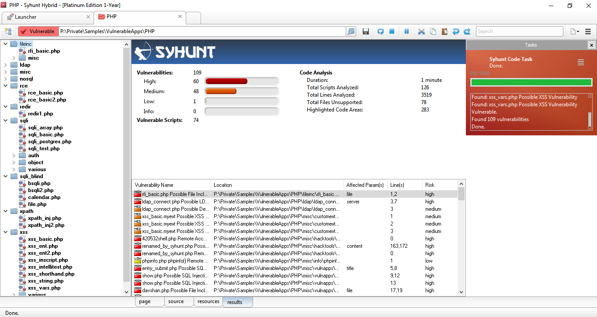
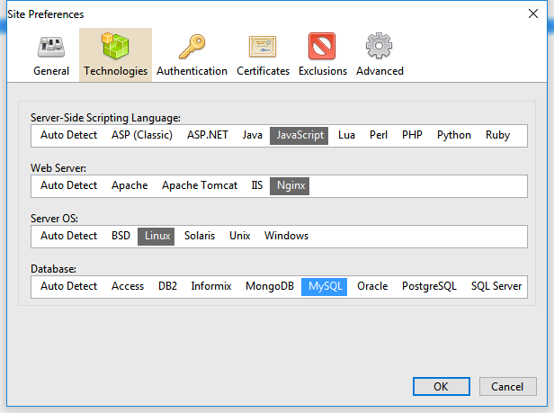
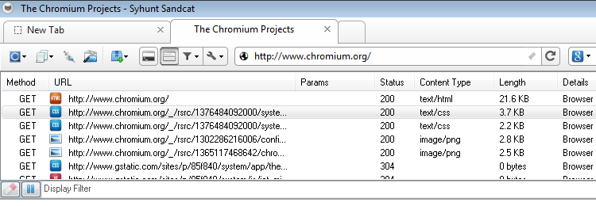
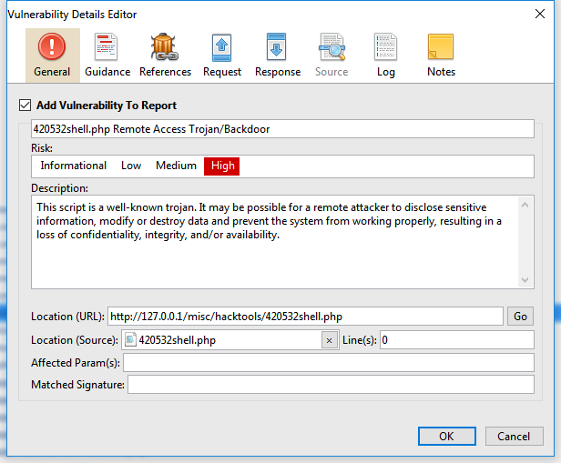
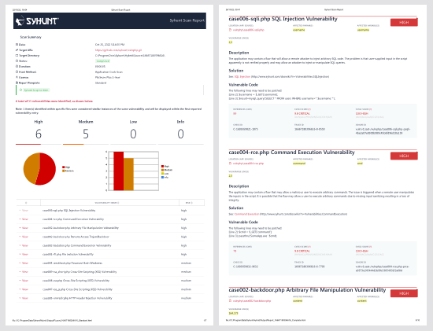

# Especificações Técnicas

> **Aplica-se a:** Syhunt Hybrid 7.2

**Conteúdo**

- [A. Direitos de licença](#License)
- [B. Arquitetura e base de vulnerabilidades](#Architecture)
- [C. Análise de código-fonte (SAST)](#SAST)
- [C2. Análise mobile e de APK (MAST)](#MAST)
- [D. Análise dinâmica (DAST)](#DAST)
- [D2. Análise aumentada (OAST)](#OAST)
- [D3. Análise híbrida aumentada (HAST)](#HAST)
- [D4. Análise de APIs (AAST)](#AAST)
- [D5. Análise forense de logs (FAST)](#FAST)
- [E. Console de gerenciamento](#Console)
- [F. Recursos de varredura](#Features)
- [G. Requisitos de sistema](#Specs)
- [H. Glossário](#Glossary)

Este documento descreve as especificações técnicas do **Syhunt Hybrid**, uma ferramenta de teste de segurança de aplicações de alta precisão e ampla cobertura. Ela combina HAST aumentado (teste híbrido de segurança de aplicações), DAST (dinâmico), SAST (estático) e MAST (mobile) para identificar vulnerabilidades e fraquezas em aplicações.

<a id="License"></a>

## A. Direitos de licença

- As licenças do Syhunt Hybrid normalmente têm validade de **12 meses**.
- As licenças incluem atualizações de versão e suporte técnico, além de documentação técnica em inglês.
- As licenças permitem um número ilimitado de varreduras de um número ilimitado de ativos por ano, iniciadas a partir de um único dispositivo (ou mais, se forem adquiridas estações adicionais). Cada licença inclui dois usuários da interface web, um administrador e mais um usuário; é possível adquirir usuários adicionais.
- Algumas licenças cobrem todas as linguagens de programação suportadas; outras cobrem pelo menos uma. É possível adquirir mais linguagens conforme a necessidade.
- As licenças permitem a integração com IA por meio de um endpoint de API configurável. Atualmente, o Syhunt suporta OpenAI, DeepSeek e modelos locais. Os custos e o hardware necessários para executar um modelo local ou na nuvem não são cobertos pelas licenças do Syhunt.

<a id="Architecture"></a>

## B. Arquitetura

O Syhunt Hybrid é uma ferramenta de avaliação de segurança de aplicações que é:

- **Híbrida:** combina várias técnicas de análise (DAST, OAST, SAST, MAST e FAST, descritas abaixo).
- **Local (on-premises):** é implantada nas instalações do cliente, de modo que o código-fonte analisado e os resultados nunca saem da rede interna.
- **Modular:** um único console de gerenciamento reúne a configuração e os resultados de todos os módulos.
- **Assíncrona:** executa várias varreduras ao mesmo tempo, sem esperar que cada uma termine.
- **Multiprocesso:** cada varredura roda como um processo separado do sistema operacional.
- **Acessível pela web e pela linha de comando:** tem uma interface web responsiva e uma CLI para iniciar varreduras dinâmicas e de código e outras tarefas.

<a id="typoftest"></a>

### Tipos de teste

| Tipo | Descrição |
|---|---|
| **[SAST](#SAST)** | Análise estática do código-fonte de aplicações web. |
| **[MAST](#MAST)** | Análise estática do código-fonte de aplicações mobile (Android e iOS) e de arquivos APK do Android. |
| **[DAST](#DAST)** | Análise dinâmica de aplicações web, com rastreamento profundo e injeção de parâmetros. |
| **[OAST](#OAST)** | Análise dinâmica aumentada de aplicações web usando técnicas out-of-band (OOB). |
| **[HAST](#HAST)** | Análise híbrida aumentada: os resultados da análise estática são usados automaticamente para aprimorar a análise dinâmica aumentada. |
| **[AAST](#AAST)** | Análise dinâmica de APIs web, orientada por uma especificação de API. |
| **[FAST](#FAST)** | Análise forense de arquivos de log de servidores web. |

<a id="typoftestend"></a>
<a id="vdb"></a>

### Base de vulnerabilidades

O Syhunt inclui uma base interna de vulnerabilidades que cobre as listas públicas de vulnerabilidades e os padrões abaixo. Ela é atualizada regularmente, para que a ferramenta acompanhe as novas vulnerabilidades publicadas por bases internacionais.

| Padrão | Cobertura |
|---|---|
| **CWE/SANS Top 25** | Most Dangerous Software Errors, 2023 ou posterior |
| **OWASP Top 10** | Web Application Security Risks, 2021 ou posterior |
| **OWASP Mobile Top 10** | Mobile Risks, 2024 ou posterior (PLUS) |
| **OWASP PHP Top 5** | |
| **CWE** | Common Weakness Enumeration |
| **CVE** | Common Vulnerabilities and Exposures |
| **ISO/IEC 27001** | |
| **WASC** | Web Application Security Consortium Threat Classification |
| **WAVSEP** | Web Application Vulnerability Scanner Evaluation Project |
| **NIST SAMATE** | Projeto Software Assurance Metrics and Tool Evaluation |
| **PCI DSS** | Payment Card Industry Data Security Standard, 3.2, 3.2.1 ou posterior |

<a id="integrations"></a>

### Integrações

| Categoria | Sistemas |
|---|---|
| **Rastreamento de issues** | Jira 7.13.0 ou posterior<br>GitHub<br>GitLab |
| **Controle de versão** | Repositórios Git públicos e privados<br>Repositórios Azure DevOps e TFS (TFVC e Git)<br>GitHub e GitLab<br>Branches |
| **APIs e scripts** | API Lua 5.1<br>API Web (REST)<br>PowerShell<br>JSON e XML<br>Selenium |
| **Painéis de segurança** | OWASP DefectDojo<br>GitLab Security Dashboard<br>Faraday |
| **Gestão de vulnerabilidades de aplicações (WAF)** | F5 BIG-IP Application Security Manager (ASM)<br>Imperva SecureSphere<br>ModSecurity CRS<br>OGASEC WAF |
| **CI/CD** | GitHub Actions<br>GitLab CI e Security Dashboard<br>Bitbucket Pipelines<br>Jenkins Pipeline |
| **Navegadores** | Extensão Syhunt Sandcat (navegadores baseados no Chromium)<br>Google Chrome<br>Mozilla Firefox |
| **E-mail** | SMTP |

Os exemplos abaixo mostram como fazer a varredura de um repositório Git por meio de cada integração:

```lua
-- Prompt de comando
scancode git://sub.domain.com/repo.git
scancode https://github.com/user/repo.git -rb:master
scancode https://dev.azure.com/user/projectname

-- Script do GitLab CI
- Start-CodeScan -pfcond 'fail-if:risk=mediumup' -output 'report.pdf' -outputex 'gl-sast-report.json'

-- Script do GitHub Actions
- Start-CodeScan -pfcond 'fail-if:risk=mediumup' -output 'report.pdf'

-- Script de pipeline do Jenkins
syhunt.scanCode([target: 'https://github.com/someuser/somerepo.git', branch: 'master', pfcond: 'fail-if:risk=mediumup'])

-- PowerShell
$MyScan = @{
  target = 'https://github.com/someuser/somerepo.git';
  branch = 'master';
  pfcond = 'fail-if:risk=mediumup';
  output = 'report.pdf'
}
Start-CodeScan @MyScan

-- Script Lua
code:scanurl('https://github.com/someuser/somerepo.git', 'master')

-- API Web (REST, JSON), POST /syhunt/launch.lua
{
  "sourcetarget": "https://github.com/someuser/somerepo.git",
  "sourcebranch": "master",
  "apikey": "YOUR_API_KEY"
}
```

<a id="Languages"></a>

### Linguagens e ambientes suportados

| Linguagem | Ambientes e frameworks |
|---|---|
| **C#** | ASP.NET Web Forms (ASPX)<br>ASP.NET Core MVC<br>.NET MAUI (iOS e Android)<br>Xamarin (iOS e Android)<br>Blazor<br>Razor Pages |
| **Dart** | Flutter (iOS e Android)<br>Lado do servidor |
| **Java** | JEE<br>JSP<br>Android<br>Spring Framework |
| **JavaScript** | Lado do cliente<br>Lado do servidor<br>Node.js (puro, Express.js e Koa.js)<br>Angular (2 ou posterior)<br>AngularJS<br>JScript (ASP Classic)<br>Electron (desktop) |
| **Kotlin** | Ktor |
| **Lua** | ngx_lua<br>mod_lua<br>CGILua<br>Lua Pages |
| **Objective-C, C e C++** | iOS |
| **Object Pascal** | Delphi<br>Delphi XE<br>Lazarus<br>DWS |
| **Perl** | |
| **PHP** | |
| **Python** | CGI<br>mod_python<br>PSP<br>WSGI<br>Django |
| **Ruby** | Rails<br>ERB<br>mod_ruby |
| **Swift** | iOS |
| **TypeScript** | |
| **VB** | VB.NET (ASP.NET)<br>VBScript (ASP Classic) |

<a id="SAST"></a>

## C. Análise de código-fonte (SAST)

| | |
|---|---|
| **Módulos** | Syhunt Code; Syhunt Mobile |
| **Descrição** | Analisa o código-fonte de aplicações web e mobile em busca de vulnerabilidades de segurança. |
| **Tipos de análise** | SAST (Static Application Security Testing)<br>MAST (Mobile Application Security Testing) |
| **Aplicações alvo** | Aplicações web (incluindo web services)<br>Aplicações mobile (Android e iOS)<br>Aplicações desktop |
| **Linguagens e plataformas alvo** | APK (Android)<br>ASP.NET e ASP Classic<br>.NET MAUI / Xamarin (iOS e Android)<br>Blazor / Razor Pages<br>Dart (Android e iOS)<br>HTML<br>Java (incluindo Android)<br>JavaScript<br>Kotlin (incluindo Android)<br>Lua<br>Objective-C, C e C++ (iOS)<br>Object Pascal (Delphi)<br>Perl<br>PHP<br>Python<br>Ruby<br>Swift (iOS)<br>TypeScript |
| **Integração com Git** | Sim |

Recursos:

- Detecta vulnerabilidades conhecidas de aplicações em todas as linguagens e ambientes suportados.
- Suporta código embutido em HTML, atalhos de impressão (print shorthands) e interpolação de strings.
- Encontra vulnerabilidades tanto do lado do cliente quanto do lado do servidor.
- Detecta scripts desatualizados e vulneráveis, locais ou remotos, como versões vulneráveis de AngularJS, jQuery, fullPage, Bootstrap e Moment.js.
- Analisa bases de código completas, trechos de código e arquivos de configuração.
- Realiza análise incremental: os principais resultados e dados das varreduras de um código são armazenados automaticamente e usados para acelerar as varreduras seguintes.
- Audita várias linguagens de programação na mesma varredura.
- Suporta TypeScript, detectando vulnerabilidades antes que o código seja compilado para JavaScript (lado do cliente e do servidor, Node.js e Angular).
- Identifica áreas-chave do código, como marcadores HTML específicos, JavaScript, requisições XHR, pontos de entrada e palavras-chave relevantes, e permite navegar entre elas.
- Encontra vulnerabilidades causadas por código mal projetado, ou seja, erros de programação que expõem o sistema a ataques.
- Detecta **shadow AI**, incluindo o uso de endpoints de API da DeepSeek, da OpenAI, compatíveis com OpenAI e de outros sistemas de IA emergentes.
- Analisa arquivos de configuração para avaliar ameaças e identificar contramedidas no nível de configuração do servidor, do ambiente ou da aplicação.
- Reconhece filtragem e validação de entradas, para resultados precisos e livres de falsos positivos.
- *Com IA:* adiciona aos relatórios exemplos de código corrigido, ao lado de cada trecho de código vulnerável.
- *Com IA:* adiciona aos relatórios uma pontuação de confiança para cada resultado, a probabilidade estimada (em porcentagem) de que seja um verdadeiro positivo e não um falso positivo.

### Visualização da varredura em tempo real



A interface mostra em tempo real o status das varreduras de código em andamento, incluindo:

- a árvore de arquivos analisados e vulneráveis;
- a duração da varredura;
- o número de scripts analisados e vulneráveis;
- o número de vulnerabilidades encontradas, no total e por severidade;
- o número de linhas analisadas;
- a lista de vulnerabilidades encontradas.


Ela também destaca os pontos do código em que uma única correção resolveria várias das vulnerabilidades encontradas.

<a id="MAST"></a>

## C2. Análise mobile e de APK (MAST)

O Syhunt Code realiza testes de segurança de aplicações mobile no código-fonte Android e iOS e em arquivos APK do Android, cobrindo os principais riscos do OWASP Mobile Top 10 e do CWE/SANS Top 25, como:

1. Uso inadequado de credenciais
2. Segurança inadequada da cadeia de suprimentos
3. Autenticação/autorização inseguras
4. Validação insuficiente de entrada/saída
5. Comunicação insegura
6. Controles de privacidade inadequados
7. Proteções insuficientes do binário
8. Configuração de segurança incorreta
9. Armazenamento de dados inseguro
10. Criptografia insuficiente

<a id="DAST"></a>

## D. Análise dinâmica (DAST)

| | |
|---|---|
| **Módulo** | Syhunt Dynamic Augmented |
| **Descrição** | Detecta vulnerabilidades de segurança em aplicações web dinâmicas e em servidores web. |
| **Tipos de análise** | DAST (Dynamic Application Security Testing)<br>OAST (Out-of-Band Application Security Testing) |
| **Aplicações alvo** | Aplicações web e servidores web |
| **Linguagens e plataformas alvo** | ASP.NET e ASP Classic<br>HTML e JavaScript<br>Java<br>Lua<br>Perl<br>PHP<br>Python<br>Ruby |
| **Otimizado para servidores HTTP** | Apache<br>Apache Tomcat<br>Microsoft IIS<br>NGINX<br>OpenResty |
| **Protocolos** | HTTP 1.0 e 1.1<br>HTTPS (SSL 2, SSL 3, TLS 1 a TLS 1.3)<br>IPv6<br>Proxies (HTTP, SOCKS 4 e SOCKS 5) |
| **Recursos HTTP** | Keep-Alive<br>Compressão GZIP<br>Autenticação: Basic, Bearer, Digest (MD5/SHA-256/SHA-512), por formulário e NTLM\* |

\* O NTLM está disponível apenas no Windows. O suporte ao Kerberos está planejado.

Recursos:

- Detecta vulnerabilidades conhecidas de aplicações web em todas as linguagens e ambientes suportados.
- Realiza **análise dinâmica aumentada**, combinando DAST e OAST.
- Realiza **análise híbrida aumentada**, combinando DAST, OAST e SAST.
- Realiza análise incremental: os principais resultados e dados das varreduras de uma URL alvo são armazenados automaticamente e usados para acelerar as varreduras seguintes.
- Suporta uma ampla variedade de [métodos de autenticação](../scanning/authenticated-scanning.md#methods), incluindo detecção automática do formulário de login (Smart e Standard), logins gravados no navegador (Recorder), logins baseados em Selenium (Selenium-Auto e scripts Node.js), autenticação HTTP e login manual pela extensão Sandcat.
- Informa se uma sessão autenticada se manteve do início ao fim de uma varredura autenticada.
- Detecta scripts, software de servidor e outros componentes desatualizados e vulneráveis.
- Encontra vulnerabilidades tanto do lado do cliente quanto do lado do servidor.
- Encontra vulnerabilidades in-band, inferenciais e out-of-band (OOB).
- Detecta aplicações vulneráveis conhecidas em todas as linguagens suportadas, incluindo ColdFusion, Flash e Server-Side Includes (SSI).
- Detecta **shadow AI** por meio de técnicas de injeção, incluindo o uso da DeepSeek, da OpenAI e de outros sistemas de IA emergentes.
- Realiza automaticamente ataques de força bruta à estrutura, a formulários de login e à autenticação HTTP.
- Detecta automaticamente páginas de logout e as evita durante a varredura, com configuração manual opcional.
- Suporta varreduras invasivas e não invasivas.
- Permite desativar testes de negação de serviço (DoS) que possam afetar a disponibilidade da aplicação.
- Permite configurar o número de novas tentativas e o tempo limite de conexão com a aplicação.
- Suporta aplicações construídas sobre sistemas de gerenciamento de conteúdo como Drupal, Joomla, Wix e WordPress.
- Suporta aplicações de página única (SPAs).
- Identifica as tecnologias usadas pela aplicação e otimiza o tempo de varredura de acordo com elas.
- Identifica versões ocultas de software de servidor e de componentes (Hunter-Sense™), como Apache, NGINX, PHP, mod_ssl, OpenSSL e Phusion Passenger.
- Injeta dados e manipula parâmetros em URLs e formulários (GET e POST).
- Aplica mutações de injeção para cobrir todas as linguagens e plataformas suportadas.
- Realiza verificações de injeção baseadas em tempo com taxa de falsos positivos de 0% para injeção de código, injeção de expression language, injeção de NoSQL, execução remota de comandos e injeção de SQL.
- Encontra vulnerabilidades como injeção de SQL, injeção de NoSQL, injeção de comandos do sistema operacional, divulgação e injeção de código usando técnicas inferenciais (tempo de resposta), in-band (mensagem de erro ou impressão), out-of-band (OOB) e passivas.
- Inclui um rastreador AJAX opcional para rastreamento profundo de aplicações com uso intenso de AJAX, construídas com frameworks populares como Angular, AngularJS e React, com suporte a pré-renderização e a local storage.

### Navegação e rastreamento

O Syhunt mapeia a estrutura da aplicação alvo, incluindo todos os links e pontos de entrada, emulando um navegador moderno com suporte a:

| Área | Suporte |
|---|---|
| **Padrões web** | HTML5<br>CSS3 |
| **Análise de HTML** | Caminhos relativos<br>HTML padrão<br>HTML fora do padrão ou malformado<br>Reconhecimento de formulários |
| **Emulação de navegador** | Google Chrome<br>Mozilla Firefox<br>Microsoft Edge<br>Envio de Referer<br>Pré-renderização<br>Local storage |
| **JavaScript** | Análise e execução de JavaScript<br>Emulação de DOM<br>Comportamento de navegador<br>Chamadas XHR (XMLHttpRequest) / AJAX<br>Arquivos JavaScript externos |
| **Simulação de interação do usuário** | Pressionamento de teclas<br>Cliques do mouse<br>Preenchimento automático de formulários<br>Login automático<br>Prevenção de logout acidental |
| **Cookies** | Gerenciamento de cookies<br>Gerenciamento de sessões |
| **Redirecionamentos** | HTTP<br>Meta refresh<br>JavaScript |
| **Isolamento de processos** | Cada varredura roda como um processo separado |
| **robots.txt** | Analisado quando disponível |

O Syhunt lida com sites grandes e complexos, com conteúdo gerado dinamicamente, e evita loops ao mapear a aplicação. Também é possível limitar a profundidade da varredura, incluindo:

- o número máximo de links por servidor e por página;
- o tamanho máximo de URL (bytes) e de resposta HTTP (kilobytes).

### Preferências de site



O Syhunt Dynamic permite criar perfis de varredura para os ativos, especificando:

- as tecnologias usadas pela aplicação (linguagem do lado do servidor, servidor web, sistema operacional e banco de dados), para otimizar o tempo de varredura;
- URLs iniciais;
- certificados SSL e credenciais de autenticação, para fazer a varredura com login no alvo;
- objetos a excluir da varredura, como caminhos, formulários e vulnerabilidades específicos;
- limites de profundidade e de camadas;
- assinaturas para detectar páginas de erro 404 personalizadas;
- cookies e tokens de sessão configurados manualmente.

### Visualização da varredura em tempo real


A interface mostra em tempo real o status das varreduras dinâmicas em andamento, incluindo:

- a árvore do site com os caminhos encontrados e vulneráveis (mapa e estrutura do site);
- a duração da varredura;
- o número de URLs vulneráveis;
- o número de URLs que usam POST, autenticação e JavaScript;
- o número de pontos de entrada;
- o número de tempos limite atingidos (timeouts);
- o número de vulnerabilidades encontradas, no total e por severidade;
- o número de verificações de segurança realizadas;
- as tecnologias web detectadas;
- o tipo de sistema operacional do alvo;
- as linguagens de programação do alvo;
- a profundidade alcançada;
- a lista de vulnerabilidades encontradas.

### Testes manuais e assistidos pelo navegador



O Syhunt Dynamic suporta testes manuais e assistidos pelo navegador. Desde a versão 7.2, isso é feito pela [extensão Syhunt Sandcat para navegador](../installation/install-windows.md#sandcat); as versões 7.1 e anteriores incluíam o navegador integrado Sandcat Browser. Os recursos incluem:

- login manual em aplicações web;
- varredura após login com CAPTCHAs, tokens e outros mecanismos de autenticação de dois fatores;
- varredura após rastreamento/navegação manual;
- captura de URLs e pontos de entrada.

O Sandcat Browser clássico (7.1 e anteriores) também oferecia cabeçalhos HTTP ao vivo; pré-visualização dos formatos de arquivo web mais comuns (CSS, Flash, HTML, BMP, GIF, ICO, JPG, PNG, SVG, JavaScript, JSON, texto e XML); desofuscação automática de JavaScript; repetição de requisições; um fuzzer; um executor de scripts; e editores HTTP/XHR com carregador de requisições.

<a id="OAST"></a>

## D2. Análise aumentada (OAST)

| | |
|---|---|
| **Módulo** | Syhunt Signal |
| **Descrição** | Detecta vulnerabilidades de segurança out-of-band em aplicações web dinâmicas. |
| **Tipo de análise** | OAST (Out-of-Band Application Security Testing) |
| **Aplicações alvo** | Aplicações web |

O Syhunt Dynamic Augmented trabalha com o serviço online **Syhunt Signal** para realizar testes out-of-band automatizados. O Syhunt Signal:

- permite ao scanner detectar variantes de alto risco de vulnerabilidades out-of-band (OOB) que, de outra forma, seriam invisíveis;
- escuta as requisições forçadas a partir de um servidor alvo vulnerável durante a varredura e as sinaliza de volta ao scanner;
- correlaciona automaticamente os alertas recebidos com as requisições de ataque que os provocaram;
- adiciona as vulnerabilidades OOB encontradas ao relatório e à interface;
- não gera falsos positivos;
- extrai automaticamente dados de um alvo vulnerável, usando comandos e técnicas específicos do ambiente e do sistema operacional, e os adiciona aos resultados da varredura;
- exige uma conexão ativa com a Internet.

Tipos de vulnerabilidades out-of-band detectados pelo Syhunt Signal:

- Execução de comandos
- Inclusão de arquivo remoto (RFI)
- Server-side request forgery (SSRF)
- Injeção de SQL
- Injeção de entidade externa XML (XXE)

<a id="HAST"></a>

## D3. Análise híbrida aumentada (HAST)

O Syhunt Hybrid combina os resultados do Syhunt Dynamic, do Syhunt Signal e do Syhunt Code para realizar a **análise híbrida aumentada** (HAST aumentado), na qual os resultados da análise estática são usados automaticamente para aprimorar a análise dinâmica aumentada. Ela:

- combina SAST, DAST e OAST;
- realiza análise híbrida do código JavaScript do lado do cliente (SAST-in-DAST);
- detecta e confirma vulnerabilidades dinamicamente, simulando ataques inferenciais, in-band e out-of-band e usando pontos de entrada e outras informações obtidas do código-fonte.

<a id="AAST"></a>

## D4. Análise de APIs (AAST)

| | |
|---|---|
| **Módulo** | Syhunt API |
| **Descrição** | Detecta vulnerabilidades de segurança em APIs web. |
| **Tipos de análise** | AAST (API Application Security Testing)<br>OAST (Out-of-Band Application Security Testing) |
| **Aplicações alvo** | APIs web |
| **Formatos de especificação** | API Blueprint, OpenAPI 2 e 3, Swagger 1 a 3, Postman Collection 1 a 2.1, GraphQL (com anotações REST), I/O Docs, Google Discovery, RAML, WADL |

Uma varredura de API começa a partir de uma especificação de API, em vez de uma URL inicial. O Syhunt mapeia a API a partir da especificação, valida se ela se comporta conforme especificado e então testa seus endpoints com as mesmas técnicas de injeção usadas nas varreduras dinâmicas, cobrindo tanto o OWASP Top 10 quanto o OWASP API Security Top 10. Consulte [Varredura de APIs Web](../scanning/api-scanning.md).

<a id="FAST"></a>

## D5. Análise forense de logs (FAST)

| | |
|---|---|
| **Módulo** | Syhunt Forensic |
| **Descrição** | Detecta ataques contra aplicações web dinâmicas. |
| **Tipo de análise** | FAST (Forensic Application Security Testing) |
| **Aplicações alvo** | Aplicações web |

O Syhunt Forensic realiza, sob demanda, análises heurísticas de segurança de logs de servidores web para detectar ataques, incluindo:

- identificação da origem (endereço IP), do país, do tipo e dos métodos das tentativas de comprometer aplicações web;
- reconstrução de sessões de ataque, separando com precisão o tráfego legítimo do malicioso e os ataques automatizados dos manuais;
- detecção de intrusões, de instalação de backdoors e das ferramentas de intrusão usadas;
- detecção de tentativas de explorar vulnerabilidades do OWASP Top 10 e do uso de técnicas de evasão de defesas;
- suporte a logs do Apache, do Microsoft IIS e do NGINX, com detecção automática de formato.

Consulte [Análise Forense de Logs](../scanning/forensic-log-analysis.md).

<a id="Console"></a>

## E. Console de gerenciamento


O console de gerenciamento reúne as configurações dos módulos e os resultados das varreduras SAST, DAST e FAST. Ele:

- dá acesso aos resultados armazenados de varreduras concluídas e em andamento;
- pode ser usado sem conhecimento prévio de segurança da informação ou de programação segura;
- exige pouca ou nenhuma intervenção do usuário antes e durante as varreduras;
- mostra graficamente o progresso e o nível de risco de cada análise em andamento;
- mostra as informações da licença: tipo de licença, data de expiração e linguagens de programação suportadas;
- permite desativar regras de detecção de vulnerabilidades e ver quais regras estão desativadas;
- permite ignorar uma ou mais vulnerabilidades específicas;
- permite pausar, retomar e cancelar varreduras imediatamente;
- permite localizar, excluir, exportar e importar resultados de varreduras;
- permite adicionar e gerenciar ativos;
- permite exportar e importar listas de alvos como arquivos CSV ou de lista;
- permite exportar e importar as configurações da ferramenta;
- mostra em tempo real a lista de vulnerabilidades encontradas;
- gera relatórios resumidos de varreduras por método de varredura;
- lista todas as sessões de um determinado mês;
- realça a sintaxe de todas as linguagens de programação suportadas;
- *(interface clássica)* inclui um bloco de notas para testes manuais, com geradores de strings de injeção comuns, geradores de hash, codificadores e decodificadores, funções HTML e manipulação de texto;
- inclui um Extension Development Kit (EDK) para adicionar novos recursos.

### Controle de acesso de usuários

- A interface web aplica uma [política de senhas rigorosa](../installation/web-ui.md#passwords):
  - comprimentos mínimos para senhas de administradores e demais usuários;
  - proibição de reutilizar senhas recentes;
  - regras de complexidade: sem o nome de usuário ou parte do nome completo do usuário; pelo menos uma letra maiúscula, uma letra minúscula, um dígito e um caractere não alfanumérico; sem três ou mais caracteres idênticos seguidos (como `AAA`) e sem três caracteres consecutivos em ordem crescente ou decrescente (como `123`, `321`, `ABC`, `CBA`).
- A interface web tem proteção integrada contra força bruta, gera IDs de sessão de forma segura e armazena as senhas com hash seguro.
- [Acesso baseado em perfis](../installation/web-ui.md#roles): Administrator, Operator, Restricted Operator e Viewer.

### Agendamento de varreduras

As varreduras agendadas suportam:

- horário, data ou dia da semana;
- tipo de varredura (dinâmica ou de código);
- alvo da varredura;
- tempo limite da varredura;
- geração de relatório, com escolha do modelo;
- envio do relatório por e-mail ao final da varredura;
- notificações para rastreadores de issues ou painéis de segurança;
- uma condição de reprovação baseada na severidade mínima;
- varreduras ocultas (sem janela);
- exportação da linha de comando para uso em agendadores de terceiros e outras ferramentas.

### Alertas de vulnerabilidades

O console de gerenciamento permite visualizar e editar alertas de vulnerabilidades, incluindo alterar seu status e severidade e adicionar comentários.



Cada alerta inclui:

- nome e descrição da vulnerabilidade;
- localização (uma URL ou um arquivo);
- referências a bases de vulnerabilidades conhecidas, como CVE, CWE, NVD e OSVDB, se houver;
- pontuação CVSS (versões 2 e 3);
- severidade (Alta, Média, Baixa ou Informativa);
- um ID de verificação único do Syhunt;
- um track ID, único para a vulnerabilidade em cada varredura;
- um guia de correção;
- parâmetros e variáveis afetados;
- números das linhas afetadas;
- um pequeno trecho do código vulnerável, quando aplicável;
- exemplos de código de correção, quando aplicável;
- a requisição, os cabeçalhos e a resposta HTTP, na análise dinâmica;
- dados extraídos, se houver;
- observações do usuário.

<a id="Features"></a>

## F. Recursos de varredura

### Relatórios e resultados



O Syhunt apresenta os resultados das varreduras e gera relatórios sobre as vulnerabilidades encontradas. Ele:

- realiza testes de aprovação/reprovação com base na severidade das vulnerabilidades encontradas;
- compara duas varreduras do mesmo alvo ou código, mostrando as vulnerabilidades novas, inalteradas e removidas em um relatório e no console de gerenciamento;
- gera relatórios em inglês, alemão, espanhol, francês, italiano, japonês, coreano e português, com descrições e soluções das vulnerabilidades traduzidas;
- envia os resultados automaticamente por e-mail para um endereço escolhido;
- gera um alerta para cada tipo único de vulnerabilidade encontrado;
- confirma, a partir de vestígios, se uma aplicação foi invadida;
- suporta CVSS 2.0 e 3.0, incluindo a pontuação base e outras métricas, para comunicar a severidade e ajudar a priorizar a resposta;
- gera relatórios em PDF e HTML (para leitura) e em XML, JSON e CSV (para outras ferramentas);
- gera relatórios HTML responsivos para celular, tablet e desktop;
- agrupa instâncias semelhantes de uma vulnerabilidade em um único item;
- ordena as vulnerabilidades por CVSS 3, CVSS 2 (de 0.0 Nenhuma a 10.0 Crítica) ou quatro níveis de severidade (Alta, Média, Baixa, Informativa);
- cria relatórios personalizados com seu próprio título, logotipo, observações e rodapé, e escolha de modelos e seções;
- gera relatórios que abrangem várias sessões selecionadas;
- adiciona automaticamente aos relatórios capturas das páginas autenticadas.

### Modelos de relatório

| Modelo | Conteúdo |
|---|---|
| **Standard** | Relatório gerencial padrão. |
| **Comparison** | Compara os resultados de uma varredura com varreduras anteriores, com gráficos e tabelas que deixam as diferenças claras. |
| **Compliance** | Relatório de aprovação/reprovação em relação ao OWASP Top 10, ao CWE/SANS Top 25 Most Dangerous Software Errors e ao PCI DSS, em suas versões atuais. |
| **Compliance (Mobile)** | Relatório de aprovação/reprovação em relação ao OWASP Mobile Top 10, ao CWE/SANS Top 25 Most Dangerous Software Errors e ao PCI DSS, em suas versões atuais. |
| **Complete** | Comparação, conformidade e todos os detalhes técnicos e das vulnerabilidades. |

Os relatórios incluem:

- detalhes gerais da varredura: data de início, alvo, status, duração e método de varredura;
- gráficos e estatísticas: total de vulnerabilidades e totais por severidade;
- detalhes das vulnerabilidades: tudo o que é exibido para cada alerta no console de gerenciamento;
- detalhes de cobertura: a estrutura mapeada, listas de formulários, e-mails, arquivos JavaScript e outros recursos encontrados, e as tecnologias e plataformas detectadas;
- a versão e uma breve descrição da licença ativa.

<a id="huntmethods"></a>

### Métodos de varredura

| Método | Foco |
|---|---|
| **Application Scan (Dynamic)** | Mapeia a estrutura do site e realiza análise passiva e ataques ativos. |
| **Application Code Scan** | Todos os tipos de vulnerabilidades no código-fonte. |
| **Application Scan (Server-Side Focused)** | Apenas vulnerabilidades do lado do servidor (dinâmica ou de código). |
| **Spider Only** | Apenas mapeia a estrutura do site, sem análise passiva nem ataques. |
| **Passive Scan** | Mapeia a estrutura do site com análise passiva, sem ataques. |
| **CWE Top 25** | O CWE Top 25 Most Dangerous Software Errors. |
| **OWASP Top 10** | O OWASP Top 10 Web Application Security Risks. |
| **PHP Top 5** | O OWASP PHP Top 5, mas não limitado a PHP. |
| **Fault Injection** | Falhas de injeção de dados, como XSS, injeção de SQL, inclusão de arquivos e execução de comandos. |
| **Structure Brute Force** | Arquivos de backup comuns, páginas de administração e exposições semelhantes. |
| **Backup Files** | Arquivos de backup, ocultos e obsoletos, de forma menos agressiva que o Structure Brute Force. |
| **Complete Penetration Test** | Todos os testes dinâmicos, de forma extensa; demorado. |
| **SQL Injection** | Injeção de SQL e de NoSQL. |
| **XSS** | Cross-site scripting e evasão de filtros anti-XSS. |
| **File Inclusion** | Inclusão de arquivo local e remoto (LFI e RFI). |
| **Malicious Content** | Malware, backdoors, pontos de entrada ocultos e sinais de intrusão. |
| **Unvalidated Redirects** | Vulnerabilidades de redirecionamento. |

Consulte [Métodos de Varredura](../scanning/hunt-methods.md) para ver os nomes na CLI e mais detalhes.

<a id="SQLI"></a>

### Detecção de injeção de SQL

O Syhunt encontra injeção de SQL e de NoSQL por análise dinâmica, usando técnicas inferenciais (baseadas em tempo), in-band (baseadas em erro) e out-of-band, e por análise de código-fonte:

| Banco de dados | DAST (inferencial) | DAST (in-band) | SAST | OAST (OOB) |
|---|---|---|---|---|
| **Injeção de NoSQL** | ✅ | ✅ | ✅ | N/A |
| MongoDB | ✅ | ✅ | ✅ | N/A |
| **Injeção de SQL** | ✅ | ✅ | ✅ | ✅ |
| Firebird/InterBase | N/A | ✅ | ✅ | N/A |
| IBM Db2 | N/A | ✅ | ✅ | N/A |
| Informix | N/A | ✅ | ✅ | N/A |
| MariaDB / MySQL | ✅ | ✅ | ✅ | N/A |
| Microsoft Access | N/A | ✅ | ✅ | N/A |
| Microsoft SQL Server | ✅ | ✅ | ✅ | ✅ |
| Oracle | ✅ | ✅ | ✅ | ✅ |
| PostgreSQL | ✅ | ✅ | ✅ | N/A |
| SQLite | ✅ | ✅ | ✅ | N/A |
| Sybase | ✅ | ✅ | ✅ | N/A |

<a id="CodeInj"></a>

### Detecção de injeção e divulgação de código

O Syhunt encontra injeção e divulgação de código por análise dinâmica, usando técnicas inferenciais (baseadas em tempo), in-band (baseadas em impressão) e passivas, e por análise de código-fonte:

| Linguagem ou ambiente | DAST (inferencial) | DAST (divulgação) | DAST (in-band) | SAST (injeção) |
|---|---|---|---|---|
| ASP Classic | ✅ | ✅ | ✅ | ✅ |
| ASP.NET | ✅ | ✅ | ✅ | ✅ |
| Java | ✅ | ✅ | ✅ | ✅ |
| JavaScript | ✅ | N/A | ✅ | ✅ |
| Lua (NGINX, Apache, CGILua e outros) | ✅ | ✅ | ✅ | ✅ |
| Object Pascal (incluindo DWS) | ✅ | N/A | ✅ | ✅ |
| Perl | ✅ | ✅ | ✅ | ✅ |
| PHP | ✅ | ✅ | ✅ | ✅ |
| Python | ✅ | N/A | ✅ | ✅ |
| Ruby | ✅ | N/A | ✅ | ✅ |
| Server-Side Includes (SSI) | N/A | ✅ | N/A | N/A |

<a id="CmdInj"></a>

### Detecção de injeção de comandos do sistema operacional

O Syhunt encontra injeção de comandos do sistema operacional por análise dinâmica, usando técnicas inferenciais (baseadas em tempo), in-band (baseadas em impressão) e out-of-band, e por análise de código-fonte:

| Sistema | DAST (inferencial) | DAST (in-band) | SAST | OAST (OOB) |
|---|---|---|---|---|
| Unix/Linux | ✅ | ✅ | ✅ | ✅ |
| Windows | ✅ | ✅ | ✅ | ✅ |
| BSD | ✅ | ✅ | ✅ | ✅ |
| Solaris | ✅ | ✅ | ✅ | ✅ |
| macOS | ✅ | ✅ | ✅ | ✅ |
| iOS | N/A | N/A | ✅ | N/A |
| Android | N/A | N/A | ✅ | N/A |

<a id="Checks"></a>

### Categorias de vulnerabilidades

O Syhunt detecta os seguintes tipos de vulnerabilidades, fraquezas e exposições em aplicações web e, quando aplicável, em aplicações mobile. Para a lista detalhada de verificações, consulte [Verificações de Vulnerabilidades](vulnerability-checks.md).

- Abuso e uso indevido de APIs
- Manipulação arbitrária de arquivos
- Backdoors (baseados na web)
- Más práticas
- Quebra de autenticação
- Criptografia quebrada
- Estouro de buffer
- Injeção de código, injeção de expression language (EL) e injeção de expressões regulares
- Execução de comandos
- Arquivos e pastas de backup comuns, e backups com extensões comuns ou duplas
- Fraquezas comuns em formulários, incluindo sequestro de formulário de e-mail, campos de preço ocultos, preenchimento automático habilitado e transações de cartão de crédito sem criptografia
- Manipulação de cookies
- Cross-site scripting (XSS), incluindo XSS baseado em DOM, XSS específico de HTML5, filtros de XSS fracos e cross-frame scripting (XFS)
- Cross-site scripting (XSS) em aplicações web com LLM
- Métodos perigosos
- Pontos de entrada de depuração, incluindo parâmetros de depuração ocultos
- Conteúdo padrão
- Negação de serviço (DoS), do lado do cliente e do servidor
- Listagem de diretórios
- Travessia de diretórios (directory traversal)
- Divulgação de caminhos, código-fonte, bancos de dados, senhas, endereços IP internos, tecnologias web e mais
- Falsificação: falsificação de logs, cross-site request forgery (CSRF) e server-side request forgery (SSRF)
- Informações sensíveis fixas no código ou registradas em logs
- Injeção de cabeçalho HTTP e divisão de resposta HTTP (HTTP response splitting)
- Conteúdo impróprio ou malicioso
- Inclusão de arquivo local ou remoto
- Vazamento de informações
- Injeção de LDAP
- Injeção de JSON, XML, XPath e XXE (entidade externa XML)
- Injeção de NoSQL, SQL e HQL
- Injeção de SSI (Server-Side Includes)
- Comunicação insegura
- Algoritmos criptográficos e de hash inseguros
- Armazenamento de dados inseguro: proteção de dados ausente ou insuficiente
- Aleatoriedade insegura
- Uso inseguro de salt
- Cabeçalhos de segurança HTTP ausentes ou fracos
- Configuração de segurança incorreta
- Informações sensíveis no lado do cliente
- Comentários suspeitos no código-fonte e no HTML
- Strings de formato não controladas
- Login sem criptografia
- Redirecionamentos não validados
- Uso de local storage, e dados confidenciais armazenados em local storage
- Hash de senha fraco
- Protocolos fracos

<a id="Specs"></a>
<a id="specsbegin"></a>

## G. Requisitos de sistema

O Syhunt Hybrid roda em Windows, macOS (Apple Silicon) e Linux de 64 bits, e pode analisar aplicações criadas para qualquer plataforma, incluindo Android, iOS, macOS, BSD, Linux, Windows, Solaris e Unix, independentemente da plataforma em que é executado.

| Requisito | Detalhes |
|---|---|
| **Memória** | 4 GB de RAM disponível (8 GB recomendados)¹ |
| **Disco** | 2 GB de espaço livre em disco² |
| **Conexão com a Internet** | Recomendada para varreduras de código e dinâmicas, e necessária para alguns recursos (consulte [Requisitos de conexão com a Internet](../installation/install-windows.md#sysreq_net)) |
| **Sistema operacional** (64 bits) | Windows 10 ou 11, ou Windows Server 2016 a 2025 (x64 ou ARM64)<br>macOS Sequoia 15.4.1 ou posterior (Apple Silicon)<br>Linux: Kali 2024.3 ou posterior, Ubuntu Server/Desktop 18 ou posterior, Debian 9 ou posterior<br>Sistemas suportados não oficialmente³, como as distribuições Linux listadas abaixo |
| **Git** | Opcional, para varreduras de repositórios Git: Git no Linux/macOS, Git for Windows no Windows |
| **Java** | Java ou Java Headless, no Linux e no macOS |
| **Wine** | Wine64 Stable, quando ainda não houver binários nativos para seu sistema ou distribuição |
| **IA** | Opcional, para recursos com IA: uma chave de API da OpenAI ou da DeepSeek, ou um modelo de IA local |

¹ Não inclui a RAM adicional que pode ser necessária para varreduras simultâneas.<br>
² Não inclui o espaço para dados das sessões de varredura, que depende do site ou do código analisado e da frequência das varreduras.<br>
³ *Suportado não oficialmente* significa que o produto foi testado com sucesso e a instalação foi documentada, mas a Syhunt não oferece suporte técnico para problemas específicos desse sistema. Você pode encontrar problemas de compatibilidade, erros ou bugs; para o melhor desempenho e compatibilidade, use um sistema suportado oficialmente.

<a id="linuxcompat_begin"></a>

### Distribuições Linux compatíveis

| Status | Distribuição |
|---|---|
| ✅ Suportadas oficialmente | Ubuntu Server/Desktop 18.10 e posteriores<br>Debian 9 e posteriores<br>Kali Linux 2024.3 e posteriores |
| ✅ Suportadas não oficialmente (testadas com sucesso) | Fedora 32 e posteriores<br>CentOS 7.7 e posteriores (Minimal ou Everything)<br>Kali Linux 2019 e posteriores<br>Parrot OS 4.1, 4.7 e posteriores<br>Linux Mint 19.2 e posteriores<br>openSUSE Leap 15.1 e posteriores<br>MX Linux 19.1 e posteriores<br>KDE neon 2020.03 e posteriores<br>Deepin 15.9<br>Manjaro 19<br>Arch Linux 2019 e posteriores |
| ❌ Não suportadas | elementary OS 5.1 (testado com sucesso) e 5.0<br>CentOS 6.1 (testado com sucesso)<br>Solus 4.1 (instável) |

Os passos de instalação de cada distribuição estão no [guia de instalação para Linux](../installation/install-linux.md).

<a id="linuxcompat_end"></a>
<a id="specsend"></a>
<a id="Glossary"></a>

## H. Glossário

| Termo | Definição |
|---|---|
| **Ataques ativos** | Análise de segurança que realiza ataques como força bruta, injeção e negação de serviço. |
| **Com IA (AI-powered)** | Um recurso, ou extensão de recurso, baseado em inteligência artificial. Disponível apenas quando há uma integração configurada com um sistema de IA suportado (OpenAI, DeepSeek ou um modelo local). |
| **Ativo** | Uma URL, arquivo de código-fonte ou repositório que pode ser analisado. |
| **Análise dinâmica aumentada** | A combinação de DAST e OAST. |
| **DAST** | Dynamic Application Security Testing (teste dinâmico de segurança de aplicações): a ferramenta interage com uma aplicação web em execução para encontrar vulnerabilidades e fraquezas. Também chamado de teste caixa-preta. |
| **DOM** | Document Object Model. |
| **FAST** | Forensic Application Security Testing (teste forense de segurança de aplicações). |
| **HAST** | Hybrid Application Security Testing (teste híbrido de segurança de aplicações): a combinação de SAST e DAST. |
| **Análise híbrida aumentada** | A combinação de SAST, DAST e OAST. |
| **Injeção** | Envio de dados aos pontos de entrada de uma aplicação e análise da resposta para determinar se seu código é vulnerável. |
| **Lua** | Uma linguagem de script leve e extensível, criada no Brasil, projetada para estender aplicações. |
| **MAST** | Mobile Application Security Testing (teste de segurança de aplicações mobile): a ferramenta analisa o código-fonte ou o pacote de uma aplicação para encontrar erros de programação e condições que indicam vulnerabilidades. |
| **NVD** | National Vulnerability Database, a base de vulnerabilidades do governo dos EUA. |
| **OAST** | Out-of-Band Application Security Testing: a ferramenta tenta fazer uma aplicação web se conectar a outros servidores, revelando vulnerabilidades que de outra forma seriam invisíveis. |
| **OOB** | Out-of-band. |
| **OSVDB** | Open Source Vulnerability Database. |
| **OWASP** | Open Worldwide Application Security Project. |
| **Análise passiva** | Análise de segurança que encontra vulnerabilidades e exposições sem realizar ataques nem chamar a atenção. |
| **PLUS** | Um recurso disponível apenas com a licença Hybrid Platinum Plus. |
| **Prova de conceito (PoC)** | Um conjunto de ações que demonstra que um produto funciona como esperado. |
| **Regra** | Uma opção que habilita ou desabilita uma ou mais verificações de vulnerabilidades. |
| **SAST** | Static Application Security Testing (teste estático de segurança de aplicações): a ferramenta analisa o código-fonte de uma aplicação para encontrar erros de programação e condições que indicam vulnerabilidades. Também chamado de teste caixa-branca. |
| **XHR** | XMLHttpRequest, uma API para enviar requisições HTTP ou HTTPS a partir de JavaScript. |
