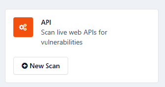

# Varredura de APIs Web

> **Aplica-se a:** Syhunt API 7.2

**Conteúdo**

- [Como funciona a varredura de APIs](#api_begin)
- [Formatos de especificação suportados](#specformats)
- [Executando uma varredura de API](#running)
- [Especificações de demonstração](#demospecs)
- [Como impedir que uma vulnerabilidade seja relatada](#advanced_vulnignore)
- [Métodos de varredura para APIs](#huntmethods_begin)
- [Agendamento de varreduras de APIs](#scheduling_begin)
- [Requisitos prévios](#apiscanreq)
- [Hospedagem e envio de especificações](#specsources)
- [Proteções contra varreduras acidentais](#safeguards)
- [Requisitos de formato das especificações](#specreqs)

## Como funciona a varredura de APIs

Uma varredura de API funciona de forma muito parecida com uma [varredura dinâmica tradicional](dynamic-scanning.md): o Syhunt injeta dados de teste nos endpoints da API e analisa as respostas para descobrir se a API é vulnerável a ataques específicos no nível da aplicação.

A diferença é o ponto de partida. Uma varredura dinâmica começa a partir de uma URL e rastreia o site; uma varredura de API começa a partir de uma **especificação da API** (uma URL ou um arquivo). Em vez de rastrear, o Syhunt mapeia a API a partir da especificação e então executa uma etapa de **validação de esquema**, uma forma de teste funcional que confirma que a API existe e se comporta conforme especificado antes do início dos testes de segurança. Se encontrar uma divergência importante, a varredura é interrompida automaticamente e um alerta é exibido, para que você não receba resultados enganosos.

## Formatos de especificação suportados

- API Blueprint
- OpenAPI 2 e 3
- Swagger 1, 2 e 3
- Postman Collection 1, 2 e 2.1
- GraphQL (com anotações REST)
- I/O Docs
- Google Discovery
- RAML
- WADL

Antes da varredura, o Syhunt verifica se a URL da especificação é válida e está em um formato suportado, e rejeita tudo o que for incompatível ou inválido. A licença básica suporta os principais formatos (OpenAPI 2 e 3, Swagger 1 a 3 e API Blueprint), que juntos representam mais de 95% das especificações de API em uso atualmente. Outras licenças podem incluir GraphQL, I/O Docs, Google Discovery, RAML e WADL.

Como as APIs são caixas-pretas, o Syhunt precisa de uma especificação para fazer a varredura: ela fornece a estrutura e as definições de endpoints que orientam os testes. O Syhunt tem ampla compatibilidade, mas recomendamos o [API Blueprint](https://apiblueprint.org/). Sua sintaxe Markdown limpa e legível, seus bons recursos de documentação e a facilidade de integração aos fluxos de desenvolvimento e teste combinam com o foco do Syhunt em facilidade de uso.

## Executando uma varredura de API

1. ⚠️ Certifique-se de atender aos [requisitos prévios](#apiscanreq) e de estar autorizado a fazer a varredura da API alvo. O Syhunt inclui [proteções](#safeguards) contra a varredura de APIs fora do seu controle direto.
2. [Habilite a interface web](../installation/web-ui.md#firststeps), caso ainda não tenha feito isso.
3. Na interface web, clique no botão **New Scan** da API. 
4. Informe a URL da especificação da API, por exemplo `http://mysite/api/openapi.json`. Para experimentar, use uma das [especificações de demonstração](#demospecs).

   > [!NOTE]
   > Você receberá um erro **Invalid target** se informar a URL da própria API em vez da URL da especificação, ou se a especificação for inválida.
5. Selecione um método de varredura. Recomendamos o **Application Scan (Default)**, que procura todas as vulnerabilidades usando as configurações recomendadas. Consulte [Métodos de Varredura](hunt-methods.md).
6. *(Opcional)* Clique em **Preferences**, ao lado da URL alvo, para personalizar as configurações da API.
7. Clique em **Start Scan**.

Você pode clicar em **View Report** a qualquer momento durante a varredura para ver os resultados obtidos até então em um relatório HTML.

Para fazer a varredura pela linha de comando, consulte [Linha de Comando: varreduras de API](../integrations/command-line.md#cli_api_begin).

## Especificações de demonstração

A interface web inclui APIs vulneráveis simuladas para demonstração e testes. Aponte o scanner para uma das URLs de especificação abaixo. Essas especificações referenciam apenas endpoints acessíveis localmente e não contêm vulnerabilidades reais; elas apenas simulam um comportamento vulnerável, para que você possa testar e aprender com segurança.

| Formato | URL da especificação |
|---|---|
| API Blueprint | `http://spec.syhunt.test/vulnapisim.apib` |
| OpenAPI 3 | `http://spec.syhunt.test/vulnapisim_openapi3.json` |
| Swagger 2 | `http://spec.syhunt.test/vulnapisim_swagger2.json` |
| Postman 2.1 | `http://spec.syhunt.test/vulnapisim_postman2.1.json` |
| Postman 1 | `http://spec.syhunt.test/vulnapisim_postman1.json` |

## Como impedir que uma vulnerabilidade seja relatada

Resultados de varreduras de API podem ser suprimidos [da mesma forma que nas varreduras dinâmicas](dynamic-scanning.md#advanced_vulnignore), usando os IDs de exclusão exibidos nos relatórios.

## Métodos de varredura para APIs

A maioria dos [métodos de varredura](hunt-methods.md) disponíveis para varreduras dinâmicas também funciona em varreduras de API, com uma diferença importante no método **Top 10**:

- Para aplicações web, ele cobre o **OWASP Top 10 para Aplicações Web**: injeção, quebra de autenticação, cross-site scripting e assim por diante.
- Para APIs, ele cobre **tanto** o OWASP Top 10 para Aplicações Web **quanto** o **OWASP API Security Top 10**, que acrescenta riscos específicos de APIs, como quebra de autorização no nível de objeto (BOLA), exposição excessiva de dados, ausência de limitação de taxa e configurações incorretas específicas de APIs.

Isso reflete um princípio da Syhunt: o OWASP Top 10 clássico continua muito relevante para APIs, pois muitos riscos de aplicações web também aparecem no nível da API. Aplicar as duas listas resulta em uma avaliação Top 10 realmente abrangente, que cobre tanto os riscos que as APIs herdam das aplicações web quanto os exclusivos das APIs.

Métodos que não se aplicam a APIs ficam indisponíveis. Se você iniciar uma varredura de API com um deles, o Syhunt a interrompe e exibe um alerta.

## Agendamento de varreduras de APIs

Varreduras de API são agendadas da mesma forma que as varreduras dinâmicas. Consulte [Agendamento de Varreduras](scheduling.md).

## Requisitos prévios

1. ⚠️ **É obrigatória uma especificação da API (URL ou arquivo).** Como as APIs são caixas-pretas, uma varredura precisa e completa é impossível sem ela: a especificação define os endpoints, parâmetros e comportamentos esperados que orientam os testes.
   - Nem sempre as equipes de segurança têm acesso às especificações das APIs. Nesse caso, peça-as à equipe de desenvolvimento antes de começar. Trate qualquer API sem documentação adequada ou especificação como um risco de segurança, pois ela não pode ser testada, revisada ou monitorada de forma eficaz.
2. ⚠️ **Somente administradores de sistema, ou outras pessoas responsáveis pelo alvo, devem usar este software. Não faça varreduras de APIs que não estejam sob seu controle direto.**
   - Se precisar fazer a varredura de uma API que você não controla, obtenha antes uma autorização por escrito do proprietário ou administrador.
   - O Syhunt inclui [proteções](#safeguards) para evitar a varredura acidental de APIs fora do controle da sua organização.
   - Como boa prática, faça backup do código-fonte e do banco de dados da API antes da varredura. Em casos raros, testes de injeção contra uma API insegura e frágil podem poluir o banco de dados ou alterar arquivos, prejudicando o funcionamento da API.
3. Certifique-se de atender aos [requisitos de conexão com a Internet](../installation/install-windows.md#sysreq_net).
4. Leia e aceite o [EULA do Syhunt](https://www.syhunt.com/en/?n=Legal.EULA) antes de iniciar qualquer varredura.

## Hospedagem e envio de especificações

Desde o Syhunt 7.1.11, você pode informar o link de uma especificação hospedada em qualquer lugar ou enviar um arquivo de especificação.

| Origem | Como funciona | Inclusões (arquivos referenciados) |
|---|---|---|
| **Hospedada** | Informe a URL da especificação. | Suportadas, desde que todos os arquivos incluídos estejam no mesmo caminho da especificação principal, ou abaixo dele. |
| **Enviada** | O Syhunt disponibiliza o arquivo em uma URL interna, como `http://spec.syhunt.test/<arquivo.ext>`. | Não suportadas. O arquivo precisa ser autossuficiente. |
| **Local** (somente Windows) | Coloque o arquivo em `C:\ProgramData\Syhunt\UserData\Specs`. Ele fica disponível em `http://localspec.syhunt.test/<arquivo.ext>`, acessível apenas pela rede interna, para reduzir a exposição. | Suportadas. O Syhunt busca os arquivos incluídos automaticamente. |

## Proteções contra varreduras acidentais

O Syhunt interrompe automaticamente uma varredura de API, a menos que uma destas condições seja atendida:

1. O host da API referenciado na especificação está em uma rede interna (uma faixa de IP privada ou um endereço de loopback).
2. O domínio da API foi explicitamente liberado ao ser adicionado à lista de alvos. Por exemplo, se a especificação aponta para `api.mydomain.com`, adicione `mydomain.com` à lista de alvos:
   - na interface web, em `http://127.0.0.1:8017/syhunt/?n=targets`; ou
   - pela CLI: `scancore -tg:https://mydomain.com -prefset:enabled -v:true`

Se nenhuma das condições for atendida, uma mensagem de erro explica o problema.

Essa proteção impede que usuários façam, sem querer, a varredura de APIs externas ou de terceiros que sua organização não controla. Ela mantém as varreduras dentro do escopo autorizado, protegendo tanto o usuário quanto sistemas externos de testes não intencionais ou não autorizados.

## Requisitos de formato das especificações

O Syhunt se esforça bastante para aceitar especificações fora do padrão ou escritas de forma pouco rigorosa, mas especificações que se afastam demais do formato oficial podem ser rejeitadas, e a Syhunt não se compromete a suportar especificações malformadas ou fora da conformidade. Se a sua for rejeitada, corrija-a ou use uma ferramenta de terceiros para colocá-la em conformidade, ou converta-a para API Blueprint para obter a melhor compatibilidade e estabilidade.

## Requisitos de sistema

Consulte as [Especificações Técnicas](../reference/technical-specifications.md#specsbegin).
