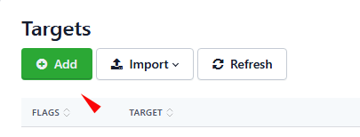
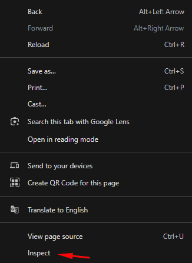
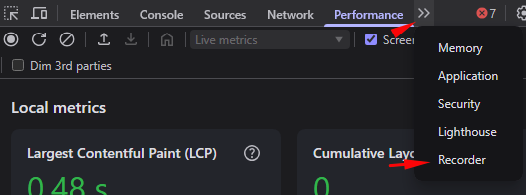
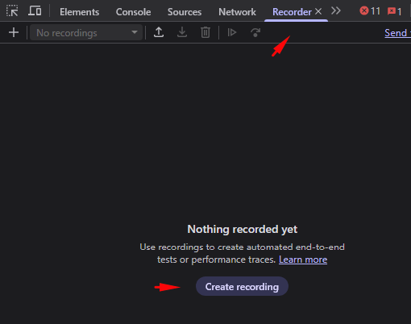
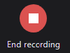
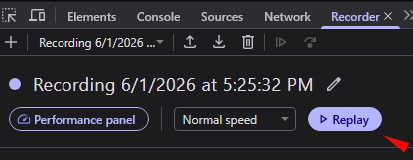
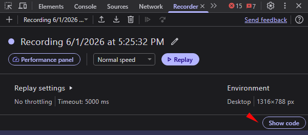
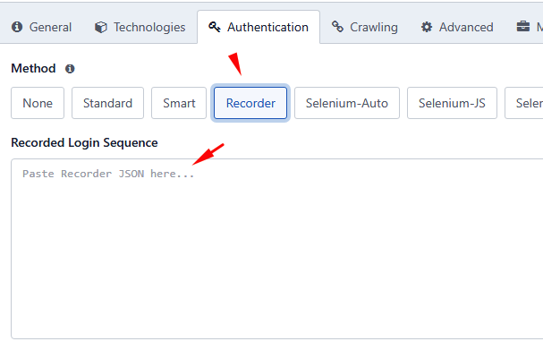

# Varredura Autenticada

> **Aplica-se a:** Syhunt Dynamic 7.2.0.24

**Conteúdo**

- [Introdução](#intro)
- [Métodos de autenticação disponíveis](#methods)
- [Novidades da versão 7.2](#whatsnew)
- [Configurando e testando a autenticação](#auth_various)
- [Gravando uma sequência de login (Recorder)](#auth_recorder)
- [Varredura com login manual (Sandcat)](#auth_manual)
- [Autenticação baseada em Selenium](#auth_selenium)
- [Varreduras agendadas com autenticação](#auth_scheduled)
- [Varreduras autenticadas pela linha de comando](#auth_cli)
- [Personalizando o preenchimento automático de formulários](#autocomplete)
- [Como evitar logout acidental](#prevlogout)
- [Uso de certificados SSL de cliente](#clientcerts)

<a id="intro"></a>

## Introdução

Desde a versão 7.2, o Syhunt Dynamic suporta uma ampla variedade de métodos de autenticação: **Standard**, **Recorder**, **Selenium-Auto**, **Selenium-JS**, **Smart**, **Basic**, **Bearer**, **Digest**, **NTLM** e **Manual**.

A maioria dos métodos é automatizada: o Syhunt Dynamic faz login usando as credenciais e configurações definidas na tela Target Preferences. Dependendo do método, ele detecta o formulário de login automaticamente, reproduz um login gravado no navegador, executa um script Selenium ou usa um mecanismo de autenticação HTTP. Quando o método permite, o Syhunt Dynamic monitora a sessão autenticada e faz login novamente de forma automática se a sessão for perdida.

A **autenticação manual** inicia uma varredura a partir de uma sessão do navegador em que você já fez login no Edge ou no Chrome, usando a extensão Syhunt Sandcat. O Syhunt Dynamic monitora essa sessão durante toda a varredura e informa se ela foi perdida antes do fim.

<a id="methods"></a>

## Métodos de autenticação disponíveis

| Método | Descrição |
|---|---|
| **None** | A autenticação fica desativada. |
| **Standard** | Login clássico por formulário, usando requisições HTTP diretas, sem sessão de navegador. |
| **Smart** | Tenta primeiro o Selenium-Auto e, se necessário, recorre ao Standard. |
| **[Recorder](#auth_recorder)** | Reproduz uma sequência de login gravada no Edge, no Chrome ou em outro navegador baseado no Chromium. |
| **[Pre (Manual)](#auth_manual)** | Usa uma sessão de navegador em que você fez login no Edge ou no Chrome, por meio da extensão Syhunt Sandcat. Diferentemente dos demais métodos, é iniciado pelo Sandcat, e não configurado na tela Target Preferences. |
| **[Selenium-Auto](#auth_selenium)** | Gera e executa automaticamente um script de login Selenium. Não exige programação. |
| **[Selenium-JS](#auth_selenium)** | Executa um script de login em Node.js fornecido por você. Por segurança, os scripts só podem ser informados pela CLI. |
| **Bearer** | Autentica as requisições com um token bearer. Comum em serviços REST, APIs web, aplicativos mobile e aplicações web modernas. |
| **Basic** | Autenticação HTTP Basic. |
| **Digest** | Autenticação HTTP Digest. |
| **NTLM** | Autenticação NTLM, comum em ambientes Windows e Active Directory. |

<a id="whatsnew"></a>

## Novidades da versão 7.2

A versão 7.2 introduz o **Syhunt Authenticator 2.0**, uma grande reformulação da estrutura de autenticação do Syhunt Dynamic.

- **Um único módulo para todos os métodos.** Antes, o autenticador cuidava principalmente dos logins baseados em Selenium. Agora ele gerencia todos os métodos de autenticação, oferecendo uma experiência de configuração mais consistente.
- **Um único lugar para configurar.** As configurações que antes ficavam separadas entre autenticação por formulário web e métodos do lado do servidor (Basic, Digest, NTLM) agora estão juntas na tela Target Preferences.
- **Novos métodos:**
  - **Recorder**: grava e reproduz sequências de login no navegador.
  - **Smart**: combina Selenium-Auto e Standard para maior compatibilidade.
  - **Selenium-Auto**: gera e executa scripts de login Selenium sem que você precise programar.
  - **Selenium-JS**: executa scripts de login personalizados escritos em Node.js.
- **Métodos removidos.** Os métodos antigos **Selenium-Python** e **AI-Powered** foram removidos. Você não precisa mais instalar e manter um ambiente Python separado e dependências de terceiros, o que também reduz a exposição a componentes externos e a ataques à cadeia de suprimentos de software. O Selenium-Auto substitui o login AI-Powered e funciona de forma muito parecida, sem exigir Python nem integração com IA.

O resultado é uma configuração de autenticação mais simples, mais segura e mais bem integrada ao fluxo de varredura do Syhunt Dynamic.

<a id="auth_various"></a>

## Configurando e testando a autenticação

1. Abra a tela **Targets** na interface web.<br>
2. Adicione a URL à lista de alvos, caso ainda não esteja nela.<br>
3. Abra o alvo e vá para a aba **Authentication**.<br>
4. Selecione o método de autenticação.
5. Informe as credenciais.
6. Clique em **Run Test** para verificar se a autenticação funciona.<br>
   - Em caso de sucesso, aparece a mensagem **Success** e uma captura da página após o login.<br>
   - Em caso de falha, aparece a mensagem **Failed** e um log de depuração.

Para instruções específicas de cada método, consulte [Recorder](#auth_recorder), [Selenium](#auth_selenium) ou [Login manual](#auth_manual).

<a id="auth_recorder"></a>

## Gravando uma sequência de login (Recorder)

Com o método **Recorder**, o Syhunt Dynamic faz login reproduzindo um login que você gravou no Edge, no Chrome ou em outro navegador baseado no Chromium. Em vez de escrever um script, você grava a si mesmo fazendo login, exporta a gravação como JSON e cola o conteúdo na tela Target Preferences. O Syhunt Dynamic reproduz os passos gravados sempre que precisar fazer login durante uma varredura.

> [!NOTE]
> **Usuários de Linux:** não use a tecla Backspace para corrigir erros de digitação durante a gravação. Se digitar algo errado, recomece a gravação. Em nossos testes, gravações com pressionamentos de Backspace às vezes falharam ao ser reproduzidas no Linux.

**1. Grave o login**

1. No Edge, no Chrome ou em outro navegador baseado no Chromium, acesse o site cuja varredura deseja fazer.
2. Clique com o botão direito na página e escolha **Inspecionar** (no final do menu).<br>
3. Abra a aba **Recorder** (Gravador).<br>
4. Clique em **Create recording** (Criar gravação).<br>
5. Informe um nome para a gravação e clique no botão vermelho **Start recording** (Iniciar gravação).<br>
6. Faça login normalmente.
7. Ao terminar, clique em **End recording** (Encerrar gravação).<br>
8. Faça logout e clique em **Replay** (Repetir), no topo, para confirmar que a gravação é reproduzida corretamente.<br>
9. Clique em **Show code** (Mostrar código), no lado direito da tela.<br>
10. Selecione o código JSON manualmente, clique com o botão direito sobre ele e escolha **Copiar**.

    > [!TIP]
    > Não use *Selecionar tudo* seguido de *Copiar*: um pequeno bug da interface do Chrome impede que o JSON inteiro seja selecionado.

**2. Adicione a gravação ao Syhunt**

1. Abra a tela **Targets** na interface web.<br>
2. Adicione a URL de login à lista de alvos, caso ainda não esteja nela.<br>
3. Abra o alvo e vá para a aba **Authentication**.<br>
4. Selecione **Recorder**.
5. Cole o JSON no campo **Recorded Login Sequence**.<br>
6. Clique em **Run Test** para confirmar que o Syhunt consegue reproduzir a gravação.<br>

<a id="auth_manual"></a>

## Varredura com login manual (Sandcat)

Com a extensão Syhunt Sandcat instalada no navegador (Edge, Chrome, Brave ou outro navegador baseado no Chromium), você pode iniciar uma varredura diretamente pelo navegador, usando a sessão estabelecida ao fazer login no site alvo.

1. Certifique-se de que a extensão [Syhunt Sandcat](../installation/install-windows.md#sandcat) está instalada e habilitada.
2. No navegador, acesse o site cuja varredura deseja fazer.
3. Faça login com suas credenciais.
4. Clique no ícone do Sandcat na barra de ferramentas do navegador e depois em **Scan This Site**.<br>
5. Uma nova tela é aberta. A mensagem verde **Session Ready** confirma que a sessão foi capturada.
6. Clique em **Start Scan**.

A seção de detalhes da sessão no relatório informa se a sessão iniciada manualmente se manteve do início ao fim da varredura (**Authenticated Session Maintained: Yes**).

<a id="auth_selenium"></a>

## Autenticação baseada em Selenium

**1. Configure o alvo**

1. Abra **Targets** no menu superior.<br>
2. Adicione a URL à lista de alvos, caso ainda não esteja nela.<br>
3. Clique na URL. A tela Target Preferences é aberta.
4. Na aba **Authentication**, selecione **Selenium-Auto** ou **Selenium-JS**. O Selenium-Auto gera o script para você; o Selenium-JS executa um script escrito por você.
5. Informe o usuário e a senha.
6. Clique em **Save**. A janela Target Preferences é fechada.
7. Se escolheu **Selenium-JS**, informe seu script pela [CLI](../integrations/command-line.md), por exemplo:

   ```
   scancore -tg:http://yourtargetapp.com -prefset:dynamic.formauth.script.seleniumjs.encrypted -fromfile:caminho/para/myseleniumscript.js
   ```

   Ao escrever o script:
   - Comece pela parte que preenche e envia o formulário de login.
   - Não chame `driver.get()` no início nem `driver.quit()` no final; o Syhunt cuida de ambos.
   - Use os marcadores `@user@` e `@pass@` para o usuário e a senha informados na aba Authentication, por exemplo `username_field.sendKeys('@user@')` e `password_field.sendKeys('@pass@')`.

**2. Teste**

1. Clique novamente na URL configurada e depois em **Run Test**.<br>
2. Se aparecer **Successful login** e uma captura da página após o login no topo da tela, a configuração está pronta para as próximas varreduras.
3. Se continuar falhando após várias tentativas, ajuste seu script Selenium e tente novamente.

Os relatórios de varreduras autenticadas incluem, no topo, uma captura do alvo após o login e a indicação de se a sessão se manteve do início ao fim.

<a id="auth_scheduled"></a>

## Varreduras agendadas com autenticação

1. Abra a tela **Scans** e clique em **Scheduled Scans**.
2. Clique em uma varredura dinâmica agendada e depois no botão **Preferences**, ao lado do campo do alvo.
3. Na aba **Authentication**, escolha o método de autenticação e informe as credenciais.

<a id="auth_cli"></a>

## Varreduras autenticadas pela linha de comando

Há duas abordagens:

- **A.** Passar as credenciais ao `scanurl` ao iniciar a varredura.
- **B.** Armazenar as credenciais antecipadamente com o `scancore`.

O método B é mais seguro, pois a senha não fica exposta na linha de comando do `scanurl`.

```lua
-- Método A: autenticação por formulário informada ao iniciar a varredura.
-- As credenciais não ficam armazenadas nas configurações do Dynamic.
scanurl http://127.0.0.1 -atype:Form -auser:yourusername -apass:yourpassword

-- Método B: autenticação armazenada para um site específico.
-- As credenciais ficam salvas nas configurações do Dynamic e são reutilizadas em todas as varreduras deste alvo.
-- Tipos disponíveis: None, Smart, Standard, Basic, Bearer, Digest e Selenium-Auto.
-- None desativa a autenticação.
scancore -tg:http://127.0.0.1 -prefset:dynamic.formauth.type -v:Standard
scancore -tg:http://127.0.0.1 -prefset:dynamic.formauth.username -v:myuser
scancore -tg:http://127.0.0.1 -prefset:dynamic.formauth.password -vsecret
-- Para autenticação Bearer, defina o token:
scancore -tg:http://127.0.0.1 -prefset:dynamic.formauth.token -vsecret
scanurl http://127.0.0.1
```

O `-vsecret` pede o valor (duas vezes, com a digitação mascarada), para que ele nunca apareça na linha de comando. Consulte [Preferências](../reference/preferences.md).

<a id="autocomplete"></a>

## Personalizando o preenchimento automático de formulários

> [!NOTE]
> Isto se aplica aos métodos **Standard**, **Smart** e **Selenium-Auto** e destina-se principalmente a cenários avançados.

O Syhunt Dynamic detecta e preenche automaticamente os campos de formulários de login na maioria das aplicações. Só é preciso configurar os campos manualmente quando o formulário usa nomes de campo fora do padrão, controles personalizados ou campos extras que não podem ser identificados automaticamente.

Por exemplo, este formulário tem um campo oculto extra e nomes fora do padrão:

```html
<input name="ClientUTBox" id="ClientUTBox" type="hidden" value="1234">
<input name="ClientUNBox" id="ClientUNBox" type="text" class="InputBox"/>User Name
<input name="ClientPWBox" id="ClientPWBox" type="password" class="InputBox">Password
```

Para indicar ao Syhunt como preenchê-lo:

1. Abra **Targets** no menu superior.<br>
2. Clique na URL do alvo (ela já deve estar na lista). A tela Target Preferences é aberta.
3. Na aba **Authentication**, clique em **Optional** para exibir as opções adicionais.
4. Clique em **Custom Fields** e adicione estas linhas:

   ```
   ClientUTBox=1234
   ClientUNBox=@syhunt_web_form_username
   ClientPWBox=@syhunt_web_form_password
   ```
5. Clique em **Save** para salvar os campos personalizados e depois em **Save**, na parte inferior da tela.

Como alternativa, defina os mesmos campos pela linha de comando:

```
scancore -tg:"[targeturl]" -prefset:dynamic.formauth.fields.encrypted -v:[ClientUTBox=1234],[ClientUNBox=@syhunt_web_form_username],[ClientPWBox=@syhunt_web_form_password]
```

Os valores que começam com `@` são variáveis internas: elas inserem nesses campos o usuário e a senha informados na tela Target Preferences. Ao terminar, clique em **Run Test** para confirmar que o login funciona com as credenciais e os campos personalizados configurados.

<a id="prevlogout"></a>

## Como evitar logout acidental

O Syhunt Dynamic detecta a maioria das páginas de logout e as evita durante o rastreamento. Se acabar acessando uma delas, normalmente ele consegue fazer login de novo automaticamente e continuar.

Para aplicações com URLs de logout personalizadas ou mecanismos de logout incomuns, você pode listar as páginas de logout para que o rastreador as evite completamente:

1. Abra a tela **Targets**.<br>
2. Abra o alvo.
3. Vá para a aba **Crawling**.
4. Em **Exclusions**, clique em **Logout URLs** e adicione sua URL de logout, por exemplo `/getmeout.php`.
5. Clique em **Save**. A janela é fechada.

<a id="clientcerts"></a>

## Uso de certificados SSL de cliente

Se o alvo exigir certificados SSL de cliente, configure-os da seguinte forma:

1. Abra **Admin → Connectors**.
2. Clique em **Add**.
3. Defina **Type** como **Web Certificate**, informe um nome para o certificado e clique em **Create**.
4. Clique no novo certificado na lista. A tela Web Certificate é aberta.
5. Selecione os arquivos do certificado e clique em **Save**.
6. Abra a tela **Targets** e clique no site que precisa do certificado. A tela Target Preferences é aberta.
7. Na aba **Advanced**, em **Certificate**, selecione o certificado na lista.
