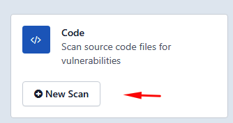

# Varredura de Código-Fonte (SAST/MAST)

> **Aplica-se a:** Syhunt Code 7.2

**Conteúdo**

- [Como fazer uma varredura de código](#code_begin)
- [Linguagens suportadas](#languages)
- [Varredura pela linha de comando](#cli)
- [Como evitar a interferência do antivírus em pipelines](#advanced_pipeline)
- [Como impedir que uma vulnerabilidade seja relatada](#advanced_vulnignore)
- [Guias relacionados](#related)

## Como fazer uma varredura de código

A varredura caixa-branca do Syhunt (varredura de código-fonte) revela muitas classes de vulnerabilidades e destaca as áreas do código que precisam de revisão. Sua análise estática detecta uma quantidade muito grande de tipos de vulnerabilidades, incluindo o CWE Top 25 de 2025 (as fraquezas de software mais perigosas) e os riscos do OWASP Mobile Top 10, em diversas linguagens de programação web e mobile.

### Linguagens suportadas: web

| Linguagem | Frameworks e variantes |
|---|---|
| C# | Blazor, Razor Pages, ASP.NET Core MVC, ASP.NET Web Forms |
| ASP Classic | VBScript e JavaScript |
| Dart | |
| Java | JEE / JSP |
| JavaScript | Lado do cliente e do servidor, Node.js, Angular, AngularJS, React, Express.js, Koa.js |
| Kotlin | Ktor |
| Lua | ngx_lua, mod_lua, CGILua, Lua Pages |
| Object Pascal | Delphi XE e anteriores, Lazarus, DWS |
| Perl | Mojolicious, PSGI/Plack, CGI |
| PHP | |
| Python | CGI, Django, mod_python, WSGI |
| Ruby | Rails, ERB |
| TypeScript | Lado do cliente e do servidor, Node.js, Angular |
| VB | VB.NET, ASP.NET Web Forms |

### Linguagens suportadas: mobile

| Linguagem | Plataforma |
|---|---|
| Java | Android |
| Kotlin | Android |
| Swift | iOS |
| Objective-C, C e C++ | iOS |
| C# | .NET MAUI, Xamarin (Android/iOS) |
| Dart | Flutter (Android/iOS) |
| Object Pascal | Delphi XE |
| JavaScript | Incluindo Node.js, Angular, AngularJS, Express.js, Koa.js |

### Executando a varredura

Siga estes passos para fazer uma varredura de código-fonte e gerar um relatório de vulnerabilidades:

1. [Habilite a interface web](../installation/web-ui.md#firststeps), caso ainda não tenha feito isso.
2. Na interface web do Syhunt, clique no botão **New Scan** do Code. 
3. Informe a URL do projeto ou o arquivo a ser verificado.
4. *(Opcional)* Se informou a URL de um projeto, também pode informar o nome de um branch. Se deixar em branco, será usado o branch principal.
5. Selecione um método de varredura. Recomendamos o **Application Code Scan (Default)**, que procura todas as vulnerabilidades usando as configurações recomendadas. Os métodos são explicados em [Métodos de Varredura](hunt-methods.md).
6. Clique em **Start Scan**.

Ao final da varredura, clique em **View Report** para abrir os resultados como relatório HTML, ou em **Export** para baixá-los no formato de sua preferência.

### Varredura pela linha de comando

Consulte [Linha de Comando: varreduras de código](../integrations/command-line.md#cli_code_begin).

## Como evitar a interferência do antivírus em pipelines

Ao analisar um código grande, o Syhunt abre todos os arquivos do repositório. Se a proteção antivírus em tempo real estiver ativada, o antivírus também verifica cada um desses arquivos, o que pode deixar a varredura consideravelmente mais lenta.

Em nossos testes em uma máquina com o Microsoft Defender, a varredura de um repositório PHP com cerca de 10.000 arquivos levou 10 minutos a mais e usou 25% mais CPU por causa do Antimalware Service (`MsMpEng.exe`). Em um pipeline de CI/CD, esses 10 minutos fazem diferença.

A solução é adicionar uma exclusão do tipo **Processo** no Defender. Uma exclusão de processo impede que o antivírus verifique os arquivos abertos pelo processo do Syhunt; já uma exclusão de *arquivo* exclui apenas o próprio executável.

Para adicionar uma exclusão de processo no Microsoft Defender:

1. Abra **Iniciar → Configurações**.
2. Em **Privacidade e segurança**, selecione **Proteção contra vírus e ameaças**.
3. Em **Configurações de proteção contra vírus e ameaças**, selecione **Gerenciar configurações**.
4. Em **Exclusões**, selecione **Adicionar ou remover exclusões** e escolha **Processo**.
5. Informe o caminho completo do scanner do Syhunt Code, `C:\Program Files\Syhunt Hybrid\ScanCode.exe`, e clique em **Adicionar**.

Se você usa outro antivírus, consulte a documentação dele para encontrar a configuração equivalente.

## Como impedir que uma vulnerabilidade seja relatada

Para suprimir resultados específicos, crie um arquivo `.vulnignore` na raiz do repositório ou da pasta verificada. Coloque um ID ou regra de exclusão por linha.

Cada vulnerabilidade de um relatório termina com seu ID de exclusão. Os IDs de exclusão são a forma mais simples e recomendada de suprimir um resultado. Para cenários mais amplos, você pode escrever [regras de exclusão](ignore-rules.md).

## Guias relacionados

- [Métodos de Varredura](hunt-methods.md): como escolher o método adequado.
- [Agendamento de Varreduras](scheduling.md): execução automática de varreduras.
- [Relatórios](reporting.md): personalização de relatórios.
- [Especificações Técnicas](../reference/technical-specifications.md#specsbegin): requisitos de sistema.
