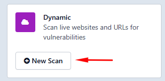
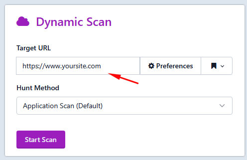

# Varredura Dinâmica (DAST)

> **Aplica-se a:** Syhunt Dynamic 7.2

**Conteúdo**

- [Como fazer uma varredura dinâmica](#dynamic_begin)
- [Login manual pelo navegador](#manuallogin)
- [Varredura pela linha de comando](#cli)
- [Varredura de endereços IPv6](#ipv6)
- [Como impedir que uma vulnerabilidade seja relatada](#advanced_vulnignore)
- [Requisitos prévios](#dynscanreq)
- [Guias relacionados](#related)

<a id="begin"></a>
<a id="dynamic_begin"></a>

## Como fazer uma varredura dinâmica

Em uma varredura dinâmica padrão (também chamada de varredura caixa-preta), o Syhunt injeta dados na aplicação web e analisa as respostas para determinar se o código é vulnerável a ataques específicos contra aplicações web.

<a id="languages"></a>

### Principais linguagens suportadas

ASP (Classic) · ASP.NET · Java / JSP · JavaScript · Lua · Perl · PHP · Python · Ruby

<a id="languagesend"></a>

### Executando a varredura

Siga estes passos para fazer uma varredura dinâmica e gerar um relatório de vulnerabilidades:

1. ⚠️ Certifique-se de atender aos [requisitos prévios](#dynscanreq) e de estar autorizado a fazer a varredura do alvo.
2. [Habilite a interface web](../installation/web-ui.md#firststeps), caso ainda não tenha feito isso.
3. Na interface web do Syhunt, clique no botão **New Scan** do Dynamic.<br>
4. Informe a URL do site cuja varredura deseja fazer.<br>
5. Selecione um método de varredura. Recomendamos o **Application Scan (Default)**, que procura todas as vulnerabilidades usando as configurações recomendadas. Os métodos são explicados em [Métodos de Varredura](hunt-methods.md).
6. *(Opcional)* Clique em **Preferences**. Na aba **Technologies**, selecione as tecnologias usadas pelo site alvo. Na mesma tela, você pode alterar outras preferências específicas do site. Revise as configurações e clique em **Save**.
7. Clique em **Start Scan**.

Ao final da varredura, clique em **View Report** para abrir os resultados como relatório HTML, ou em **Export** para baixá-los no formato de sua preferência.


<a id="manuallogin"></a>

### Login manual pelo navegador

Consulte [Varredura com login manual (Sandcat)](authenticated-scanning.md#auth_manual).

<a id="cli"></a>

### Varredura pela linha de comando

Consulte [Linha de Comando: varreduras dinâmicas](../integrations/command-line.md#cli_dynamic_begin).

<a id="ipv6"></a>

### Varredura de endereços IPv6

O Syhunt Dynamic suporta totalmente alvos IPv6. Coloque o endereço entre colchetes, por exemplo:

```
http://[2001:4860:0:2001::68]/index.php
```

<a id="advanceddyn"></a>
<a id="advanced_vulnignore"></a>

## Como impedir que uma vulnerabilidade seja relatada

Você pode impedir que vulnerabilidades específicas sejam relatadas usando IDs de exclusão (ignore IDs) ou regras de exclusão:

1. Abra **Targets** no menu<br><br>e clique no alvo na lista.
2. Vá para a aba **Manage**.
3. No grupo **Exclusions**, clique em **Vulnerabilities**.
4. Digite o ID ou a regra de exclusão e clique em **Add**.


Cada vulnerabilidade de um relatório termina com seu ID de exclusão. Os IDs de exclusão são a forma mais simples e recomendada de suprimir um resultado. Para cenários mais amplos, você pode escrever [regras de exclusão](ignore-rules.md).

Para dúvidas comuns, consulte as [Perguntas Frequentes](../getting-started/faq.md#dynamic_begin).

<a id="dynscanreq"></a>
<a id="dynscanreq_begin"></a>

## Requisitos prévios

1. ⚠️ **Somente administradores de sistema, ou outras pessoas responsáveis pelo alvo, devem usar este software. Não faça varreduras de sites que não estejam sob seu controle direto.**
   - Se precisar fazer a varredura de um site que você não controla, obtenha antes uma autorização por escrito do proprietário ou administrador.
   - Como boa prática, faça backup do código-fonte e do banco de dados do site antes da varredura. Em casos raros, testes de injeção contra um site inseguro e frágil podem poluir o banco de dados ou alterar arquivos, prejudicando o funcionamento do site.
2. Certifique-se de atender aos [requisitos de conexão com a Internet](../installation/install-windows.md#sysreq_net).
3. Leia e aceite o [EULA do Syhunt](https://www.syhunt.com/en/?n=Legal.EULA) antes de iniciar qualquer varredura.

<a id="dynscanreq_end"></a>
<a id="related"></a>

## Guias relacionados

- [Métodos de Varredura](hunt-methods.md): como escolher o método adequado.
- [Varredura Autenticada](authenticated-scanning.md): varredura de áreas protegidas por login.
- [Agendamento de Varreduras](scheduling.md): execução automática de varreduras.
- [Relatórios](reporting.md): personalização de relatórios.
- [Especificações Técnicas](../reference/technical-specifications.md#specsbegin): requisitos de sistema.
