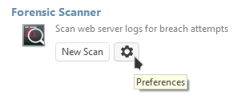

# Análise Forense de Logs

> **Aplica-se a:** Syhunt Forensic 7.0.13

> [!IMPORTANT]
> No Syhunt Hybrid 7.2, o Forensic está disponível apenas pela linha de comando (o comando `scanlog`; consulte o [guia de Linha de Comando](../integrations/command-line.md)). Uma atualização futura o tornará disponível novamente pela interface web. Os passos de interface abaixo se aplicam a versões anteriores.

## Introdução

O Syhunt Forensic (antigo Syhunt Insight) investiga comprometimentos de aplicações web e ajuda a evitar novas invasões. Ele identifica com rapidez e precisão a origem, o tipo e os métodos de um ataque, para que as organizações possam corrigir as falhas e se defender de novas ameaças.

O Syhunt Forensic não é um produto independente. Ele complementa as ferramentas de teste dinâmico (DAST) e estático (SAST) do Syhunt, concentrando-se na análise pós-incidente e na investigação de invasões: enquanto o DAST e o SAST encontram e corrigem vulnerabilidades durante o desenvolvimento e a implantação, o Forensic mostra em detalhes o que aconteceu em ataques que já ocorreram. Juntos, eles cobrem tanto a prevenção quanto a resposta.

## Formatos de log suportados

O Syhunt Forensic reconstrói sessões de ataque a partir dos logs dos servidores web mais populares. Ele se baseia nos detalhes registrados nesses logs para distinguir o tráfego legítimo do malicioso e os ataques automatizados dos manuais, por isso precisa ter acesso a eles:

- Apache
- Nginx
- Microsoft IIS
- Lighttpd

## Fazendo uma varredura forense

1. Abra o Syhunt Hybrid e clique no ícone do Syhunt Forensic, ou em **New Scan**, na página de boas-vindas. 
2. Selecione o arquivo de log do servidor web a ser analisado. Normalmente é um arquivo com extensão `.log`, como `access.log`, ou um arquivo cujo nome começa com `access_log` e não tem extensão.
3. Aguarde o fim da varredura.

Ao final da varredura, o log recebe um destes status:

| Status | Significado |
|---|---|
| 🟢 **No attacks** | Nenhum ataque à segurança de aplicações foi encontrado no log. |
| 🟠 **Attack Attempts Found** | Há sinais de possíveis ataques, mas nenhuma invasão confirmada. |
| 🔴 **Breached** | Há sinais de possíveis ataques **e** de uma invasão bem-sucedida. |

Clique em **Save Results**  na barra de ferramentas para salvar a lista de tentativas de ataque.

## Reconstruindo a sessão de um atacante

O Syhunt Forensic pode reconstruir sessões de ataque inteiras a partir do log, separando o tráfego legítimo do malicioso e os ataques automatizados dos manuais. Isso ajuda a entender a dimensão completa de um incidente.

1. Clique duas vezes em um ataque na lista.
2. Na barra inferior, clique em **View All Requests**.
3. Uma nova aba é aberta. Aguarde a conclusão da reconstrução.

## Exportando a lista de atacantes

Você pode exportar os endereços IP identificados como atacantes e usar a lista para reforçar as regras do seu firewall, bloqueando esses endereços de forma proativa para evitar novos ataques das mesmas origens.

Ao final da varredura, clique no ícone de arquivo mostrado abaixo e escolha **Save Attacker List**.

## Excluindo endereços IP da análise

1. Clique em **Preferences**. 
2. Vá para a aba **Exclusions**.
3. Clique em **Source IPs**.
4. Adicione os endereços IP a serem ignorados ou importe-os de um arquivo.
5. Clique em **OK** para salvar a lista e depois em **OK** novamente para fechar a janela de preferências.
6. Execute a varredura novamente.
