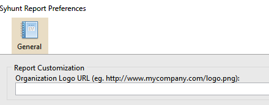

# Relatórios

> **Aplica-se a:** Syhunt Hybrid 6.9

## Personalização dos relatórios

Antes de salvar um relatório, você pode escolher o idioma e adicionar o logotipo da sua organização. As configurações valem para todos os relatórios gerados a partir de então.

1. Clique em **Edit Report Preferences** na barra de ferramentas. A janela **Report Preferences** é aberta. 
2. Informe a URL da imagem que contém o seu logotipo. 
3. Escolha o idioma de saída.
4. Clique em **OK** para salvar.

Os relatórios gerados a partir de agora exibirão o logotipo da sua organização no lugar do logotipo da Syhunt.

## Exportação dos resultados

Ao final de uma varredura, clique em **Export** na tela de resultados para baixá-los no formato de sua preferência. Para a lista completa de formatos de relatório e exportação, consulte as [Especificações Técnicas](../reference/technical-specifications.md).
