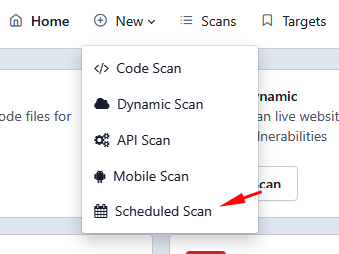
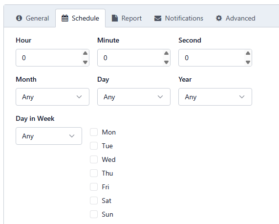
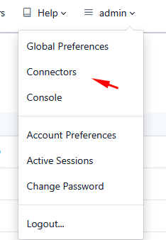
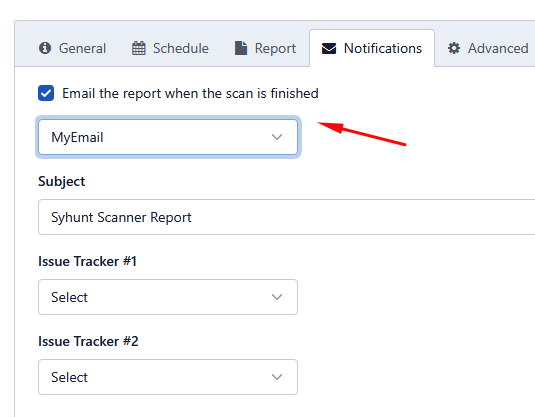

# Agendamento de Varreduras

> **Aplica-se a:** Syhunt Hybrid 7.2

## Como agendar uma varredura

1. [Habilite a interface web](../installation/web-ui.md#firststeps), caso ainda não tenha feito isso.
2. Na interface web do Syhunt, clique em **New → Scheduled Scan**. 
3. A tela **Schedule New** é aberta.
4. Na aba **General**, informe um nome para a varredura agendada (por exemplo, `MyScan`), preencha os dados do alvo e escolha um método de varredura.
5. Na aba **Report**, defina as opções de geração de relatório.
6. Na aba **Schedule**, defina quando a varredura deve ser executada. 
7. Clique em **Save**.
8. Confirme que o novo agendamento aparece na lista de varreduras agendadas, em `https://127.0.0.1:8018/syhunt/?n=scanschedule`.

## Envio de relatórios por e-mail

**1. Crie um conector de e-mail**

1. Clique em **Connectors** no menu superior da interface web. 
2. Clique em **Add**. A tela **New Connector** é aberta.
3. Informe um nome para o conector (por exemplo, `MyEmail`).
4. Defina **Type** como **Email**.
5. Clique em **Create** e, após a mensagem de sucesso, em **Close**.

**2. Configure o conector**

1. Clique no conector que você acabou de criar. A tela de preferências dele é aberta.
2. Informe os endereços de e-mail do remetente e do destinatário.
3. Informe o host SMTP e as credenciais de autenticação.
4. Clique em **Save**.

**3. Associe o conector a uma varredura agendada**

1. Abra **Scans** no menu superior e clique em **Scheduled Scans**.
2. Clique na varredura agendada cujos relatórios devem ser enviados por e-mail. A janela de preferências dela é aberta.
3. Na aba **Notifications**, selecione **Email the report when the scan is finished**. 
4. Escolha seu conector de e-mail na lista (`MyEmail` na captura de tela acima).
5. Clique em **Save**.

## Consulta dos resultados

Você pode consultar os resultados de varreduras anteriores e em andamento a qualquer momento: abra a página inicial do Syhunt Hybrid e clique em **Scans** no menu superior.

