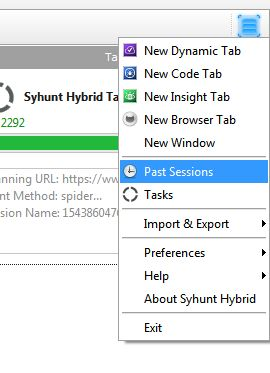
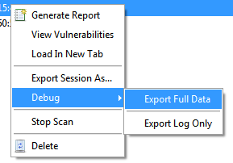

# Como Relatar Bugs e Obter Suporte

> **Aplica-se a:** Syhunt Hybrid 6.8.20

**Conteúdo**

- [Varreduras DAST longas](#lenghtyscans)
- [Como relatar um falso positivo](#falsepositivereport)
- [Como relatar um falso negativo](#falsenegativereport)
- [Como relatar um problema de rastreamento](#crawlingissuereport)
- [Como relatar outros bugs](#bugreport)
- [Como criar um log de depuração](#debuglogcreation)
- [Como abrir um ticket de suporte](#supportticketcreation)

## Varreduras DAST longas

A varredura de um site com muito conteúdo gerado dinamicamente pode levar bastante tempo. Consulte [Ajuste de Desempenho](../installation/performance-tuning.md) para entender o motivo e como resolver.

## Como relatar um falso positivo

Um *falso positivo* é um resultado que, após revisão manual, se mostra não ser uma vulnerabilidade ou fraqueza. Para relatá-lo e permitir a correção:

1. Descreva cada falso positivo com o máximo de detalhes possível.
2. [Crie um log de depuração](#debuglogcreation).
3. [Abra um ticket de suporte](#supportticketcreation) e anexe os arquivos de depuração e sua descrição.

## Como relatar um falso negativo

Um *falso negativo* é uma vulnerabilidade que existe no site ou código alvo, mas não foi detectada. Para relatá-lo e permitir a correção:

1. Descreva o tipo de vulnerabilidade (por exemplo, injeção de SQL).
2. **Varreduras de código:** inclua os **trechos relevantes** do código-fonte que contêm a vulnerabilidade não detectada.
3. **Varreduras dinâmicas:** descreva o caso com o máximo de detalhes possível, incluindo:
   - a URL afetada, se houver;
   - os passos usados para confirmar a vulnerabilidade;
   - para falhas de injeção, o parâmetro afetado, os dados injetados e uma amostra da resposta da aplicação.
4. [Crie um log de depuração](#debuglogcreation).
5. [Abra um ticket de suporte](#supportticketcreation) e anexe os arquivos de depuração, sua descrição e eventuais trechos de código.

## Como relatar um problema de rastreamento

1. Informe se a URL alvo está protegida por alguma barreira, como autenticação por formulário de login. Isso nos ajuda a analisar o procedimento, a configuração ou o método usado e a sugerir ou fazer ajustes na ferramenta.
2. Se a URL que não está sendo rastreada corretamente estiver acessível, envie-a para nós com credenciais de teste (se necessário), para que possamos testá-la diretamente em nosso laboratório.
3. Se isso não for possível, [crie um log de depuração](#debuglogcreation).
4. [Abra um ticket de suporte](#supportticketcreation) e anexe os arquivos de depuração e uma descrição do problema.

## Como relatar outros bugs

1. Descreva o problema com o máximo de detalhes possível, para que possamos investigá-lo e reproduzi-lo em nosso laboratório.
2. Faça uma captura de tela do problema.
3. [Crie um log de depuração](#debuglogcreation).
4. [Abra um ticket de suporte](#supportticketcreation) e anexe os arquivos de depuração, sua descrição e a captura de tela.

## Como criar um log de depuração

1. Abra a tela de sessões em **Menu → Past Sessions**.

   

2. Clique com o botão direito na sessão que deseja depurar e escolha **Debug → Export Full Data** para salvar o arquivo.

   

Isso cria um arquivo de depuração com a extensão `.sse`. Envie-o à Syhunt para análise.

## Como abrir um ticket de suporte

Um ticket de suporte é a melhor forma de relatar um bug ou pedir ajuda.

1. Acesse a [área de tickets de suporte](https://syhunt.ladesk.com/my_tickets#My-Tickets) e clique em **Submit Ticket**.
2. Se ainda não tiver uma conta, clique em **Register**, informe um endereço de e-mail válido e seu nome e clique em **Register**. Verifique seu e-mail para obter os dados de acesso, volte à página de login, entre e clique em **Submit Ticket**.
3. Preencha o formulário: escreva sua mensagem, anexe os arquivos necessários e clique em **Send**.

Um agente de suporte da Syhunt analisará o problema, e você receberá por e-mail uma cópia de cada resposta. O prazo esperado de resposta é de 1 a 2 dias úteis. Você pode acompanhar o status dos seus tickets em [My Tickets](https://syhunt.ladesk.com/my_tickets#My-Tickets) e responder por e-mail ou pela área de tickets.
